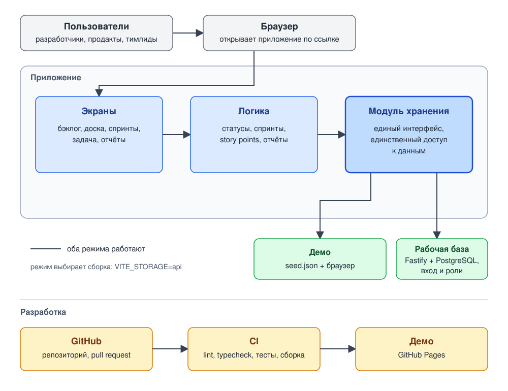

# team-tracker

Трекер задач и спринтов для команд разработки: проекты с ключами задач, бэклог, доски, спринты, story points, burndown и velocity.

**Статус: в разработке.** Сейчас готовы только документы и данные для демонстрации (этап 0–1); приложения ещё нет. Стек утверждён: React + TypeScript + Vite, позже Node.js + Fastify + PostgreSQL ([ADR-002](docs/adr/002-stack.md)).

## Документы

- [docs/features.md](docs/features.md) — возможности для пользователей
- [docs/vision.md](docs/vision.md) — видение, функции MVP и этапы
- [docs/quality.md](docs/quality.md) — нефункциональные требования
- [docs/architecture.md](docs/architecture.md) — подробная архитектура, схемы, потоки, развёртывание
- [docs/capabilities.md](docs/capabilities.md) — возможности и бизнес-правила по модулям
- [docs/data-model.md](docs/data-model.md) — сущности и ER-диаграмма
- [docs/adr/](docs/adr/) — архитектурные решения ([шаблон](docs/adr/0000-template.md), [ADR-001](docs/adr/001-storage-module.md), [ADR-002: стек](docs/adr/002-stack.md))

## PDF

- [docs/pdf/architecture.pdf](docs/pdf/architecture.pdf) — архитектура
- [docs/pdf/capabilities.pdf](docs/pdf/capabilities.pdf) — возможности

Пересборка: `python3 scripts/build_diagrams.py`, `node scripts/svg_to_png.js`, `python3 scripts/build_pdf.py` (нужны reportlab и шрифт DejaVu Sans).

## Данные

- [data/seed.json](data/seed.json) — демонстрационные данные (проект DEMO)
