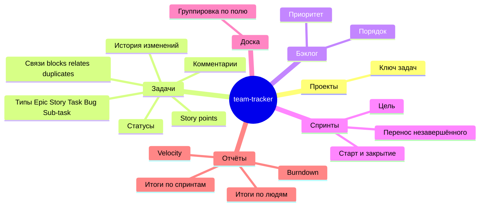
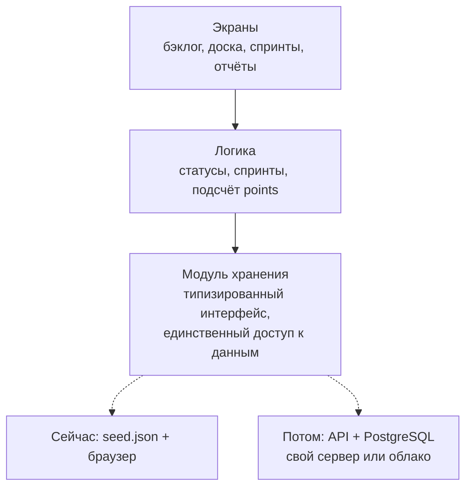

# Архитектура

Общая схема: пользователи, приложение по слоям, источники данных и путь разработки. Стек на ней не показан — он ещё не утверждён.

## Функции продукта

Карта функций MVP из [vision.md](vision.md).

## Слои

Экраны работают только с логикой, логика — только с модулем хранения ([ADR-001](adr/001-storage-module.md)). Источник данных меняется без правок выше по стеку. Итоги и отчёты считаются в слое логики и не хранятся.

## Варианты стека

Общее для обоих вариантов: TypeScript, Vite, Vitest, ESLint + Prettier, CI на GitHub Actions (lint, typecheck, test, build).

### Вариант A — React + Node (Fastify) + PostgreSQL

- **Фронтенд:** React, React Router, TanStack Query, dnd-kit для перетаскивания, Zustand для локального состояния.
- **Бэкенд (позже):** Node.js + Fastify, Zod для валидации, Drizzle ORM, PostgreSQL.
- **Плюсы:** самая большая экосистема и выбор готовых библиотек (доски, drag-and-drop, графики); один язык на фронте и бэке, общие типы и схемы Zod; много разработчиков знают стек.
- **Минусы:** больше решений «собери сам» (роутинг, состояние, формы); React требует дисциплины для производительности на больших списках; бандл тяжелее.

### Вариант B — Svelte (SvelteKit SPA) + Hono + PostgreSQL

- **Фронтенд:** Svelte 5 + Vite, свой небольшой роутер или SvelteKit в режиме SPA, графики на uPlot/D3.
- **Бэкенд (позже):** Hono на Node (или Bun), Zod, Kysely, PostgreSQL.
- **Плюсы:** малый бандл и быстрый отклик «из коробки»; меньше шаблонного кода; реактивность проще для досок и больших списков.
- **Минусы:** экосистема меньше (drag-and-drop и таблицы приходится дописывать самим); меньше разработчиков на рынке; Svelte 5 моложе.

Окончательный выбор — за вами; после утверждения оформим его как ADR-002.
