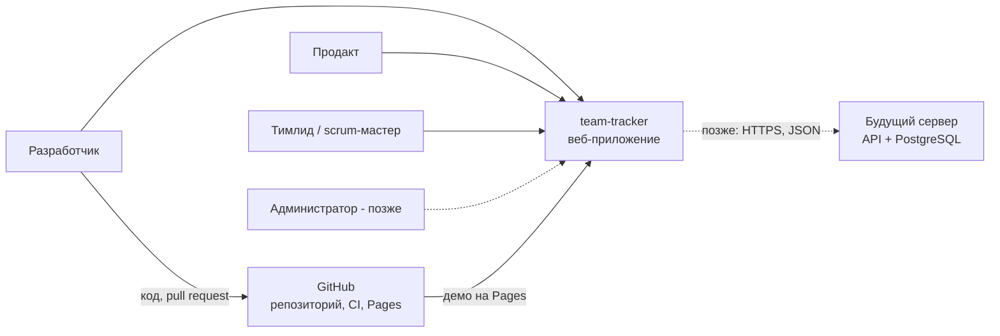
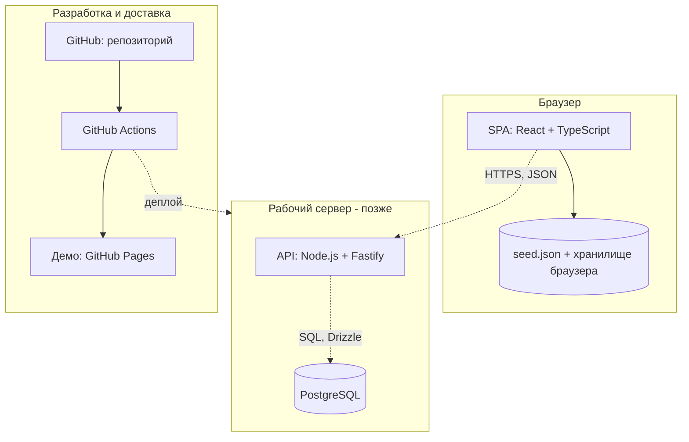
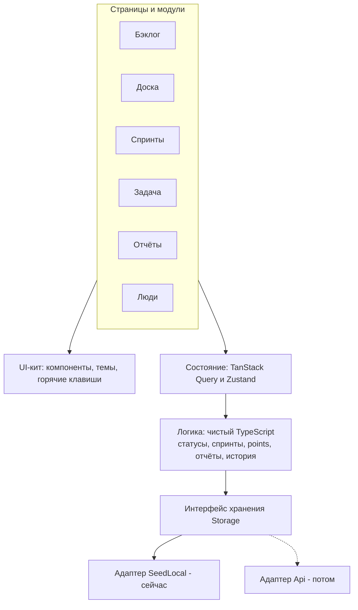
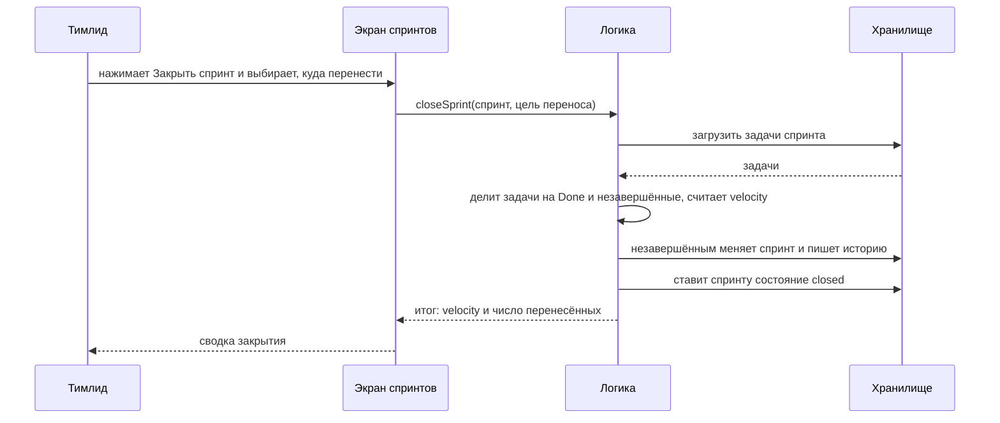
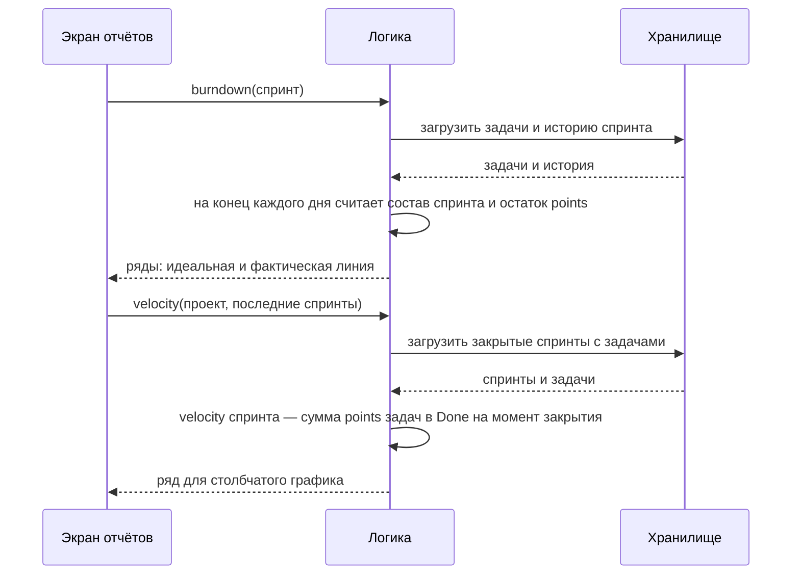

# Архитектура team-tracker

Версия документа 0.1. Статус продукта: в разработке. Стек утверждён: [ADR-002](adr/002-stack.md).


Общая схема: пользователи, приложение по слоям, источники данных и путь разработки.

## 1. Назначение и принципы

team-tracker — трекер задач и спринтов для команд разработки. Документ описывает, из чего состоит система, как слои взаимодействуют и как продукт развивается от демо без сервера до рабочей базы.

Принципы:

- **Один путь к данным.** Экраны и логика не знают, откуда берутся данные; доступ только через модуль хранения ([ADR-001](adr/001-storage-module.md)).
- **Логика отдельно от интерфейса.** Правила (статусы, спринты, points, отчёты) — чистый TypeScript без React; их проверяют модульными тестами.
- **Вычисляемое не хранится.** Итоги по людям и спринтам, burndown и velocity считаются из задач и истории.
- **История не переписывается.** Запись в History только добавляется.
- **Сначала демо, потом сервер.** Первые этапы работают на `seed.json` и браузере, сервер подключается заменой адаптера.
- **Проверка на границах.** Данные проверяются при вводе в интерфейсе и при записи в хранилище.

## 2. Контекст системы


<!-- pdf: diagrams/context.png -->

Пользователи работают в браузере. Код и pull request живут в GitHub; CI собирает приложение и публикует демо на GitHub Pages. Сервер с API и PostgreSQL появится на этапе 8; до этого данные приходят из `seed.json` и хранилища браузера.

## 3. Контейнеры


<!-- pdf: diagrams/containers.png -->

SPA — единственное приложение для пользователя. Сейчас оно использует адаптер SeedLocal; позже — адаптер Api, который обращается к Fastify. API проверяет данные (Zod) и пишет в PostgreSQL через Drizzle. CI проверяет каждый pull request и публикует демо; деплой на рабочий сервер добавляется позже.

## 4. Компоненты фронтенда


<!-- pdf: diagrams/components.png -->

**Страницы и маршруты.** Все адреса начинаются с `/projects/:key`:

| Страница | Маршрут | Назначение |
|----------|---------|------------|
| Бэклог | `/projects/:key/backlog` | Порядок и приоритет задач, отправка в спринт |
| Доска | `/projects/:key/board` | Задачи спринта по статусам, группировка по полю |
| Спринт | `/projects/:key/sprints/:id` | Цель, состав, запуск и закрытие |
| Задача | `/projects/:key/issues/:number` | Карточка, связи, комментарии, история |
| Отчёты | `/projects/:key/reports` | Итоги, burndown, velocity |
| Люди | `/projects/:key/people` | Участники и их нагрузка |

**Модули** (`modules/tasks`, `backlog`, `sprints`, `board`, `reports`, `people`) содержат страницы, компоненты и запросы одной области.

**Логика** (`domain/`) — чистые функции и небольшие сервисы. Сервисы получают модуль хранения как зависимость, поэтому в тестах подставляется версия в памяти.

**Модуль хранения** — интерфейс `Storage` с типизированными методами (проекты, задачи, спринты, связи, комментарии, история) и два адаптера: **SeedLocal** (читает `seed.json`, сохраняет изменения в браузере) и **Api** (HTTP-клиент к Fastify). Оба адаптера проходят один и тот же набор контрактных тестов.

**UI-кит** — общие компоненты, светлая и тёмная тема, обработка горячих клавиш.

**Состояние.** Данные с сервера или из хранилища — TanStack Query (кэш, обновление после изменений). Состояние интерфейса — Zustand: выбранная группировка доски, фильтры, тема.

## 5. Стек

| Слой | Технология | Зачем |
|------|-----------|-------|
| Язык | TypeScript (строгий режим) | Типы на всех слоях, общие типы с бэкендом |
| Сборка | Vite | Быстрый запуск и сборка |
| Интерфейс | React | Зрелая экосистема, много готовых решений |
| Маршруты | React Router | Адрес у каждой задачи, доски и спринта |
| Данные | TanStack Query | Кэш, повторные запросы, оптимистичные обновления |
| Состояние интерфейса | Zustand | Простое локальное состояние без шаблонного кода |
| Перетаскивание | dnd-kit | Доска и порядок в бэклоге, работа с клавиатуры |
| Тесты | Vitest | Быстрые модульные тесты на TypeScript |
| Стиль кода | ESLint + Prettier | Единый стиль, поиск ошибок |
| CI/CD | GitHub Actions | Проверки и публикация демо |
| Сервер (позже) | Node.js + Fastify | Лёгкий и быстрый API |
| Проверка данных (позже) | Zod | Схемы на входе API, общие с фронтендом |
| Доступ к БД (позже) | Drizzle ORM | Типизированные запросы и миграции |
| База (позже) | PostgreSQL | Надёжное хранение, транзакции |

Версии — актуальная стабильная на момент старта этапа.

## 6. Модель данных

Сущности и поля: [data-model.md](data-model.md). Ключевые правила:

- номер задачи уникален в проекте; полный номер — `KEY-число`, например `DEMO-12`;
- `sprintId = null` — задача в бэклоге; `order` задаёт порядок;
- иерархия: Epic — без родителя; Story, Task и Bug — внутри Epic или Story; Sub-task — внутри Story, Task или Bug;
- story points — у Story, Task и Bug; у Sub-task и Epic их нет;
- связь не может ссылаться саму на себя и повторяться;
- History только добавляется: смены статуса, исполнителя, points и спринта;
- итоги по людям и спринтам, burndown и velocity не хранятся — считаются;
- даты — ISO 8601, время в UTC.

## 7. Ключевые потоки

### 7.1. Смена статуса задачи с записью в историю


<!-- pdf: diagrams/seq-status.png -->

Правило переходов проверяет логика, а не экран: так оно одинаково работает на доске, в карточке задачи и с клавиатуры. Задача и запись истории пишутся одной операцией, чтобы они не расходились.

### 7.2. Закрытие спринта с переносом незавершённого


<!-- pdf: diagrams/seq-sprint-close.png -->

Цель переноса — следующий спринт или бэклог. Закрытие делается одной операцией: либо переносится всё, либо ничего.

### 7.3. Расчёт burndown и velocity


<!-- pdf: diagrams/seq-reports.png -->

Отчёты ничего не хранят: каждый раз они строятся из задач и истории. Поэтому точность burndown зависит от полноты истории (смены статуса, points и спринта) — см. [capabilities.md](capabilities.md), раздел «Вопросы на согласование».

## 8. Структура репозитория

Структура будущего проекта (создаётся на этапе 3):

```
team-tracker/
  .github/workflows/   CI: lint, typecheck, тесты, сборка, Pages
  data/                seed.json
  docs/                документы, ADR, схемы, PDF
  scripts/             сборка PDF и схем
  src/
    app/               точка входа, маршруты, провайдеры
    modules/           tasks, backlog, sprints, board, reports, people
    domain/            чистая логика без UI
    storage/           интерфейс, seed-local, api
    ui/                общие компоненты, темы, горячие клавиши
    state/             Zustand-хранилища интерфейса
  server/              API (Fastify), миграции Drizzle (позже)
  .env.example         пример переменных окружения
  package.json
```

## 9. Качество

**Пирамида тестов:**

- основание — модульные тесты `domain/` на Vitest: переходы статусов, перенос при закрытии спринта, points, burndown, velocity;
- середина — контрактные тесты модуля хранения: один набор для SeedLocal и Api;
- верх — несколько сквозных проверок основных сценариев (набор инструментов решим отдельным ADR).

**Линтеры:** ESLint (в том числе запрет импортов хранилища мимо модуля), Prettier, TypeScript в строгом режиме.

**Этапы CI** для каждого pull request: установка зависимостей, lint, проверка форматирования, typecheck, тесты, сборка. На `main` после успеха — публикация демо.

**ADR:** значимые решения записываются в `docs/adr/` по шаблону.

## 10. Развёртывание

- **Локально:** `npm install`, затем `npm run dev` — приложение на `seed.json` и хранилище браузера, сервер не нужен.
- **Демо:** сборка в CI и публикация на GitHub Pages. Для маршрутов SPA на Pages нужна страница-запасной вариант (404.html) или маршрутизация через хэш — решается на этапе 3.
- **Рабочий сервер (этап 8):** Docker Compose с тремя сервисами: веб-сервер (раздаёт SPA и проксирует API), Node.js с Fastify, PostgreSQL с постоянным томом. Резервные копии: ежедневный дамп PostgreSQL в отдельное хранилище, хранение нескольких последних копий, регулярная проверка восстановления.

## 11. Безопасность (позже)

- **Вход:** учётные записи и сессии на сервере; в демо входа нет.
- **Роли и права:** разработчик, продакт, тимлид/scrum-мастер, администратор ([capabilities.md](capabilities.md)); права проверяются на сервере, а не только в интерфейсе.
- **Данные:** проверка всех входных данных схемами Zod; параметризованные запросы через Drizzle.
- **Секреты:** пароли, ключи и строка подключения к базе — в `.env` и секретах CI; в репозиторий не попадают (`.env` в `.gitignore`, в репозитории только `.env.example`).
- **Транспорт и сервер:** HTTPS, ограничение числа запросов, регулярные обновления зависимостей.

## 12. Риски и принятые решения

| Риск | Мера |
|------|------|
| Переход на API потребует переписать приложение | Доступ к данным только через модуль хранения; контрактные тесты для обоих адаптеров |
| Burndown неточен без полной истории | Писать в историю статус, исполнителя, points и спринт; решение по записи создания задачи — на согласовании |
| Медленный интерфейс на больших списках | Виртуализация списков; оптимистичные обновления через TanStack Query |
| Маршруты SPA на GitHub Pages | 404.html или хэш-маршруты; решение на этапе 3 |
| Потеря данных на рабочем сервере | Регулярные резервные копии и проверка восстановления |
| Расхождение документов и кода | ADR для значимых решений; документы обновляются вместе с кодом |

**Решения (ADR):**

| ADR | Тема | Статус |
|-----|------|--------|
| [ADR-001](adr/001-storage-module.md) | Доступ к данным через модуль хранения | принято |
| [ADR-002](adr/002-stack.md) | Выбор технологического стека (вариант A) | принято |
| ADR-003 | Хранение истории и расчёт отчётов | предстоит |
| ADR-004 | Маршруты SPA на GitHub Pages | предстоит |
| ADR-005 | Вход и роли на сервере | предстоит |
