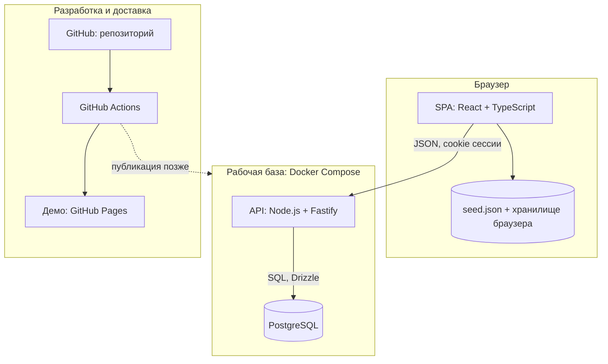
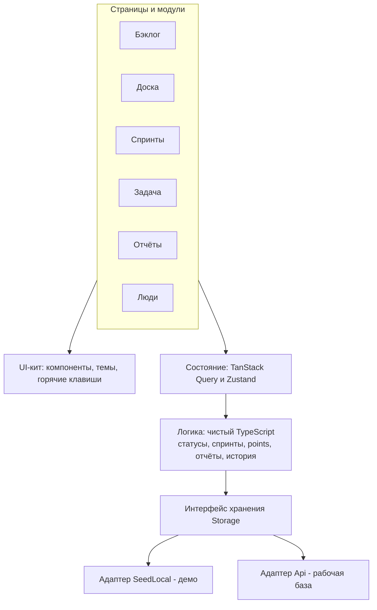
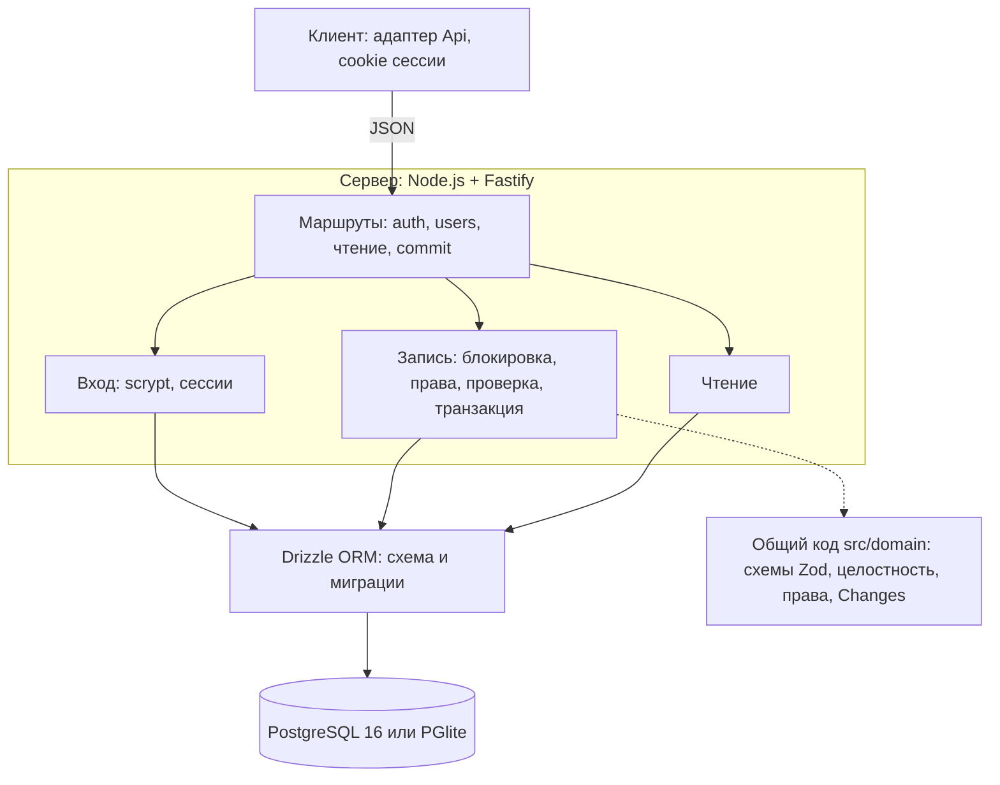
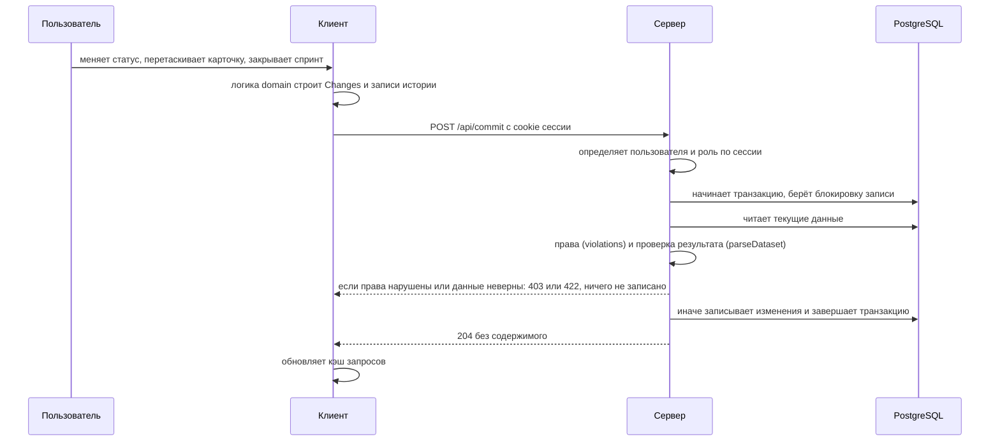
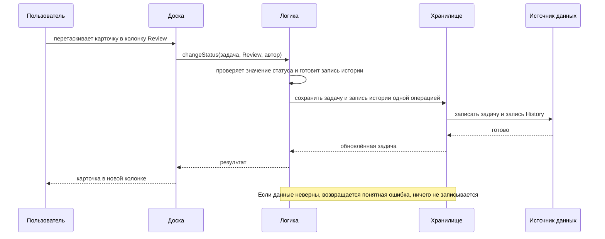
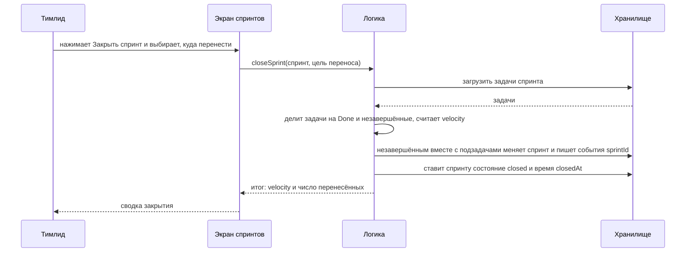
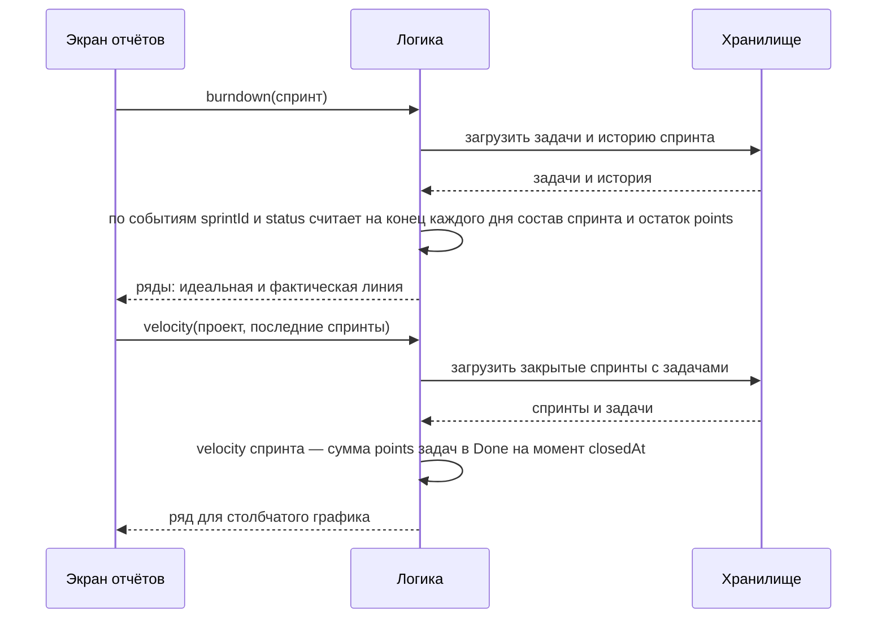

# Архитектура team-tracker

Версия документа 0.9. Статус продукта: в разработке. Стек утверждён: [ADR-002](adr/002-stack.md).


Общая схема: пользователи, приложение по слоям, два режима хранения (демо в браузере и рабочая база на сервере) и путь разработки.

## 1. Назначение и принципы

team-tracker — трекер задач и спринтов для команд разработки. Документ описывает, из чего состоит система, как слои взаимодействуют и как продукт работает в двух режимах: демо без сервера и рабочая база с входом и ролями.

Принципы:

- **Один путь к данным.** Экраны и логика не знают, откуда берутся данные; доступ только через модуль хранения ([ADR-001](adr/001-storage-module.md)).
- **Логика отдельно от интерфейса.** Правила (статусы, спринты, points, отчёты) — чистый TypeScript без React; их проверяют модульными тестами.
- **Вычисляемое не хранится.** Итоги по людям и спринтам, burndown и velocity считаются из задач и истории.
- **История не переписывается.** Запись в History только добавляется.
- **Два режима одним кодом.** Демо работает на `seed.json` и браузере, рабочая база — через сервер; режим меняет только адаптер хранения.
- **Сервер не доверяет клиенту.** Права, структура и целостность проверяются на сервере при каждой записи ([ADR-010](adr/010-server-auth-roles.md)).
- **Проверка на границах.** Данные проверяются при вводе в интерфейсе и при записи в хранилище.

## 2. Контекст системы


<!-- pdf: diagrams/context.png -->

Пользователи работают в браузере. Код и pull request живут в GitHub; CI собирает приложение и публикует демо на GitHub Pages. Рабочая база — сервер с API и PostgreSQL, вход по учётке и роли (этап 8, [ADR-010](adr/010-server-auth-roles.md)); демо на Pages по-прежнему работает на `seed.json` и хранилище браузера, без входа.

## 3. Контейнеры


<!-- pdf: diagrams/containers.png -->

SPA — единственное приложение для пользователя. В демо оно использует адаптер SeedLocal; в рабочей базе — адаптер Api, который обращается к Fastify (сборка с `VITE_STORAGE=api`). API проверяет права и данные (Zod, целостность) и пишет в PostgreSQL через Drizzle; он же отдаёт собранное приложение. CI проверяет каждый pull request и публикует демо; публикация рабочей базы на внешний сервер — отдельное решение.

## 4. Компоненты фронтенда


<!-- pdf: diagrams/components.png -->

**Страницы и маршруты.** Все адреса начинаются с `/projects/:key`:

| Страница | Маршрут | Назначение |
|----------|---------|------------|
| Бэклог | `/projects/:key/backlog` | Порядок и приоритет задач, отправка в спринт |
| Доска | `/projects/:key/board` | Задачи спринта по статусам, группировка по полю |
| Спринт | `/projects/:key/sprints/:id` | Цель, состав, запуск и закрытие |
| Задача | `/projects/:key/issues/:number` | Карточка, связи, комментарии, история |
| Отчёты | `/projects/:key/reports` | Итоги, burndown, velocity |
| Люди | `/projects/:key/people` | Участники и их нагрузка |
| Настройки | `/projects/:key/settings` | Длительность, название и дата следующего спринта |

**Модули** (`modules/tasks`, `backlog`, `sprints`, `board`, `reports`, `people`) содержат страницы, компоненты и запросы одной области.

**Логика** (`domain/`) — чистые функции и небольшие сервисы. Сервисы получают модуль хранения как зависимость, поэтому в тестах подставляется версия в памяти.

**Модуль хранения** — интерфейс `TrackerStorage` с типизированными методами (проекты, задачи, спринты, связи, комментарии, история) и два адаптера: **SeedLocal** (читает `seed.json`, сохраняет изменения в браузере) и **Api** (HTTP-клиент к Fastify). Вход (экран входа, сессия, выход) и права ( `usePermissions` ) находятся рядом с хранением: `src/app/AuthGate`, `src/state/session`, `src/domain/permissions`.

**UI-кит** — общие компоненты, светлая и тёмная тема, обработка горячих клавиш.

**Состояние.** Данные с сервера или из хранилища — TanStack Query (кэш, обновление после изменений; с сервером ещё и по возвращении на вкладку). Состояние интерфейса и сессии — Zustand: группировка доски, фильтры, вошедший пользователь.

## 5. Компоненты сервера


<!-- pdf: diagrams/server.png -->

Сервер (`server/src`) невелик и намеренно не содержит бизнес-правил: их считает клиент в `src/domain`, а сервер проверяет результат тем же кодом.

| Часть | Файл | Что делает |
|-------|------|-----------|
| Маршруты | `app.ts` | `/api/auth/*` (регистрация, вход, выход, «кто я»), `/api/users` (роли), чтение по проектам, задачам, спринтам, связям, истории, `POST /api/commit`; статика собранного приложения и `index.html` для адресов SPA |
| Вход | `auth.ts`, `passwords.ts` | создание учётки (регистрация закрыта по умолчанию; участников создаёт администратор с временным паролем), вход, смена и сброс пароля, сессии (хэш токена в базе), смена роли, ограничение перебора |
| Запись | `repo.ts` | под блокировкой: загрузка данных, `violations` (права), `parseDataset` (структура и целостность), запись в одной транзакции |
| База | `db/schema.ts`, `migrations/` | таблицы `projects`, `people`, `sprints`, `issues`, `links`, `comments`, `history`, `users`, `sessions`; уникальные индексы (ключ проекта, номер задачи, почта) |
| Запуск | `main.ts`, `config.ts`, `lock.ts` | настройки из `.env`; `DATABASE_URL` — PostgreSQL, иначе PGlite в `DATA_DIR` ([ADR-011](adr/011-local-pglite.md)); метка занятой базы не даёт открыть PGlite дважды |
| Команды | `admin-cli.ts`, `backup-cli.ts`, `seed-cli.ts` | `npm run admin:create` (первый администратор), `backup` и `restore` (копии PGlite), `db:seed` (демо-данные) |

### 5.1. Запись изменения на сервере


<!-- pdf: diagrams/seq-commit.png -->

Один путь записи для всех действий: права и целостность проверяются на сервере независимо от того, что скрыл интерфейс. Блокировка выстраивает записи в очередь, поэтому проверка и запись видят одно и то же состояние.

## 6. Стек

Версии — из `package-lock.json` на момент выпуска 0.8.

| Слой | Технология | Версия | Зачем |
|------|-----------|--------|-------|
| Язык | TypeScript (строгий режим) | 6.0 | Типы на всех слоях; общий код `src/domain` у клиента и сервера |
| Рантайм | Node.js | 22 | Сервер, сборка, тесты |
| Сборка клиента | Vite | 8.3 | Быстрый запуск и сборка |
| Интерфейс | React | 19.3 | Зрелая экосистема |
| Маршруты | React Router | 8.5 | Адрес у каждой задачи, доски и спринта |
| Данные клиента | TanStack Query | 5.105 | Кэш, повторные запросы после изменений |
| Состояние | Zustand | 5.0 | Интерфейс и сессия без шаблонного кода |
| Перетаскивание | dnd-kit (core, sortable) | 6.3 / 10.0 | Доска и порядок в бэклоге, работа с клавиатуры |
| Проверка данных | Zod | 4.6 | Одни схемы у клиента и сервера, русские сообщения |
| Сервер | Fastify (+ cookie, static) | 5.12 | Лёгкий API, отдаёт и собранное приложение |
| Доступ к БД | Drizzle ORM, drizzle-kit | 0.45 / 0.31 | Типизированные запросы и миграции |
| База | PostgreSQL | 16 | Транзакции, блокировки, надёжное хранение |
| Драйвер | pg (node-postgres) | 8.23 | Подключение к PostgreSQL |
| Встроенная база | PGlite | 0.5 | PostgreSQL в процессе: запуск на своём компьютере без установки PostgreSQL, тесты |
| Запуск сервера | tsx | 4.23 | Запуск TypeScript без отдельной сборки сервера |
| Пароли | `crypto.scrypt` (Node) | — | Хэш с солью без нативных зависимостей |
| Тесты | Vitest | 5.0 | Модульные и серверные тесты (136) |
| Стиль кода | ESLint, typescript-eslint, Prettier | 10.13 / 8.72 / 3.9 | Единый стиль, запрет импорта хранилища мимо модуля |
| Контейнеры | Docker, Docker Compose | — | Запуск `app` и `db` одной командой (необязательно) |
| CI/CD | GitHub Actions | — | Проверки каждого pull request, публикация демо |
| Документы | Python (reportlab), Chromium (Playwright) | — | Схемы, макеты и PDF |

## 7. Модель данных

Сущности и поля: [data-model.md](data-model.md). Ключевые правила:

- номер задачи уникален в проекте; полный номер — `KEY-число`, например `DEMO-12`;
- `sprintId = null` — задача в бэклоге; `order` задаёт порядок;
- иерархия: Epic → Story, Task или Bug → Sub-task; Task в Story не вкладывается; Sub-task всегда в спринте родителя;
- story points — целое ≥ 0 у Story, Task и Bug; у Sub-task и Epic их нет;
- допустим любой переход статусов, каждый пишется в историю; статус Epic задаётся вручную;
- `Sprint.closedAt` — момент закрытия; закрытый спринт только для чтения;
- связь не может ссылаться саму на себя и повторяться;
- History только добавляется: создание задачи, смены статуса, исполнителя, points и спринта;
- итоги по людям и спринтам, burndown и velocity не хранятся — считаются;
- даты — ISO 8601, время в UTC.

## 8. Ключевые потоки

### 7.1. Смена статуса задачи с записью в историю


<!-- pdf: diagrams/seq-status.png -->

Допустим любой переход между статусами ([ADR-003](adr/003-business-rules.md)), поэтому логика проверяет только значение статуса и всегда пишет запись истории. Это делает логика, а не экран, поэтому поведение одинаково на доске, в карточке задачи и с клавиатуры. Задача и запись истории пишутся одной операцией, чтобы они не расходились.

### 7.2. Закрытие спринта с переносом незавершённого


<!-- pdf: diagrams/seq-sprint-close.png -->

Цель переноса — существующий спринт в состоянии planned, бэклог или новый спринт, созданный из окна закрытия. Sub-task переносится вместе с родителем. Закрытие делается одной операцией: либо переносится всё, либо ничего; после `closedAt` спринт только для чтения.

### 7.3. Расчёт burndown и velocity


<!-- pdf: diagrams/seq-reports.png -->

Отчёты ничего не хранят: каждый раз они строятся из задач и истории. Поэтому точность burndown зависит от полноты истории: создание задачи, смены статуса, points и спринта пишутся всегда ([ADR-003](adr/003-business-rules.md)).

## 9. Структура репозитория

```
team-tracker/
  .github/workflows/   CI: lint, typecheck, тесты, сборка, Pages
  data/                seed.json
  docs/                документы, ADR, схемы, PDF
  scripts/             проверка seed, сборка PDF и схем, резервные копии
  src/
    app/               точка входа, маршруты, вход (AuthGate), выбор хранилища
    modules/           projects, tasks, backlog, sprints, board, reports, people, auth
    domain/            типы, схемы Zod, логика и права без UI (общий код)
    storage/           интерфейс, seed-local, api
    ui/                общие компоненты и стили
    state/             запросы, действия, сессия, текущий пользователь
  server/
    src/               API (Fastify): маршруты, вход, запись, база, загрузка seed
    migrations/        SQL-миграции Drizzle
  start.cmd            запуск двойным щелчком (Windows), scripts/start.mjs — `npm run start`
  .env.example         все настройки с комментариями (.env в репозиторий не попадает)
  Dockerfile           образ: сборка клиента и запуск сервера
  docker-compose.yml   app + PostgreSQL
  package.json
```

## 10. Качество

**Пирамида тестов:**

- основание — модульные тесты `domain/` на Vitest: переходы статусов, перенос при закрытии спринта, points, burndown, velocity;
- середина — серверные тесты (`server/src/*.test.ts`) на PGlite: вход, роли, права, чтение, запись, отклонение неверных данных, конфликт номеров, закрытая регистрация, временные пароли, настройки, метка занятой базы, круговая проверка копии и восстановления; плюс контрактные тесты SeedLocal;
- верх — ручные сквозные проверки в браузере (Playwright) против настоящего PostgreSQL: вход, права по ролям, смена роли, выход.

**Линтеры:** ESLint (в том числе запрет импортов хранилища мимо модуля), Prettier, TypeScript в строгом режиме.

**Этапы CI** для каждого pull request: установка зависимостей, lint, проверка форматирования, typecheck, тесты, сборка. На `main` после успеха — публикация демо.

**ADR:** значимые решения записываются в `docs/adr/` по шаблону.

## 11. Развёртывание

- **Демо (без сервера):** `npm install`, `npm run dev` — приложение на `seed.json` и хранилище браузера. Сборка в CI и публикация на GitHub Pages только из `main`; адреса остаются обычными, `index.html` копируется в `404.html` ([ADR-005](adr/005-pages-routing.md)).
- **Свой компьютер, без Docker и PostgreSQL** ([ADR-011](adr/011-local-pglite.md)): `start.cmd` (Windows, двойной щелчок) или `npm run start` — сборка интерфейса при необходимости и сервер на встроенной базе PGlite (`DATA_DIR`, по умолчанию `./local-data`); интерфейс и API на http://localhost:3000, слушает только этот компьютер (`HOST=127.0.0.1`; `0.0.0.0` — вся локальная сеть). Первый администратор — `npm run admin:create`, копии — `npm run backup` и `npm run restore <файл>` (при остановленном трекере). Все настройки — `.env` (образец `.env.example`). Демо-данные: `npm run db:seed`. Для разработки интерфейса: `npm run server:dev` и `VITE_STORAGE=api npm run dev` (Vite проксирует `/api` на сервер).
- **Рабочая база, Docker Compose:** при заданном `POSTGRES_PASSWORD` (обязателен) `docker compose up -d --build` поднимает `db` (PostgreSQL 16, постоянный том) и `app` (Node.js: Fastify отдаёт API и собранное приложение); адрес http://localhost:3000, миграции применяются при старте. Первый администратор: `docker compose run --rm app npm run admin:create`. Демо-данные: `docker compose run --rm app npm run db:seed`.
- **Резервные копии:** на встроенной базе — `npm run backup` и `npm run restore <файл>` (архив папки данных, при остановленном трекере); с PostgreSQL — `scripts/backup.sh` (сжатый `pg_dump`) и `scripts/restore.sh файл`; в обоих случаях в `backups/` хранится 14 последних. Ежедневный запуск (cron) и вынос копий на другую машину настраивает владелец.
- **Внешний сервер** ([ADR-010](adr/010-server-auth-roles.md)): не настроен. Понадобятся HTTPS-прокси перед `app` (с `COOKIE_SECURE=true`), пароль базы в `POSTGRES_PASSWORD`, копии вне сервера.

## 12. Безопасность

- **Вход:** почта и пароль (не короче 8 символов), пароль — `scrypt` с солью; регистрация закрыта по умолчанию, участников создаёт администратор с временным паролем, который нужно сменить при первом входе ([ADR-011](adr/011-local-pglite.md)); сессия — случайный токен, в базе только его хэш; cookie `httpOnly`, `SameSite=Lax`, `Secure` за HTTPS; срок 7 дней, выход и смена роли действуют сразу; ограничение перебора пароля.
- **Роли и права:** разработчик, продакт, тимлид/scrum-мастер, администратор ([capabilities.md](capabilities.md)); права проверяются на сервере при каждой записи, интерфейс лишь скрывает недоступное. Автор записи — всегда пользователь сессии.
- **Данные:** все входные данные проверяются схемами Zod и проверкой целостности; запросы к базе параметризованы (Drizzle); запись — в транзакции под блокировкой.
- **Секреты:** пароль базы и прочие значения — в переменных окружения (`.env` в `.gitignore`); в репозитории их нет.
- **Транспорт и сервер:** по умолчанию сервер слушает только `127.0.0.1`; доступ по сети включается явно (`HOST=0.0.0.0`). HTTPS и ограничение запросов обеспечивает прокси перед `app` (при публикации); зависимости обновляются регулярно.
- **Ограничения тестовой версии:** нет подтверждения почты и восстановления пароля; история событий формируется клиентом ([ADR-010](adr/010-server-auth-roles.md)).

## 13. Риски и принятые решения

| Риск | Мера |
|------|------|
| Переход на API потребует переписать приложение | Доступ к данным только через модуль хранения; контрактные тесты для обоих адаптеров |
| Burndown неточен без полной истории | Писать в историю создание задачи, статус, исполнителя, points и спринт; проверять полноту тестами и `scripts/check_seed.py` |
| Медленный интерфейс на больших списках | Виртуализация списков; оптимистичные обновления через TanStack Query |
| Маршруты SPA на GitHub Pages | `404.html` как копия `index.html` и базовый путь сборки ([ADR-005](adr/005-pages-routing.md)) |
| Потеря данных на рабочем сервере | Резервные копии `scripts/backup.sh`, проверка восстановления `scripts/restore.sh` |
| Клиент отправляет недопустимое изменение | Сервер сам проверяет права, структуру и целостность каждой записи |
| Двойной запуск повредит встроенную базу | Метка занятой базы: второй запуск, копия и восстановление отказывают ([ADR-011](adr/011-local-pglite.md)) |
| Две правки одновременно | Запись под блокировкой, последняя побеждает; дубль номера задачи — конфликт 409 |
| Расхождение документов и кода | ADR для значимых решений; документы обновляются вместе с кодом |

**Решения (ADR):**

| ADR | Тема | Статус |
|-----|------|--------|
| [ADR-001](adr/001-storage-module.md) | Доступ к данным через модуль хранения | принято |
| [ADR-002](adr/002-stack.md) | Выбор технологического стека (вариант A) | принято |
| [ADR-003](adr/003-business-rules.md) | Бизнес-правила: решения по вопросам на согласование | принято |
| [ADR-004](adr/004-screen-decisions.md) | Решения по макетам экранов | принято |
| [ADR-005](adr/005-pages-routing.md) | Маршруты SPA на GitHub Pages | принято |
| [ADR-006](adr/006-demo-author-and-order.md) | Демо-режим: автор действий, порядок в списках, версия seed | принято |
| [ADR-007](adr/007-board.md) | Доска спринта: колонки, группировка, перенос карточек | принято |
| [ADR-008](adr/008-sprints.md) | Спринты и настройки проекта | принято |
| [ADR-009](adr/009-reports.md) | Отчёты: burndown, velocity, нагрузка людей | принято |
| [ADR-010](adr/010-server-auth-roles.md) | Рабочая база: сервер, вход и роли | принято |
| [ADR-011](adr/011-local-pglite.md) | Локальное развёртывание на PGlite | принято |
