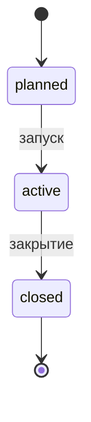

# Возможности team-tracker

Версия документа 0.4. Статус продукта: в разработке. Отметки: **[MVP]** — первая версия, **[Позже]** — после неё.

## 1. Назначение, пользователи, глоссарий

team-tracker — трекер задач и спринтов для команд разработки. Он помогает вести бэклог, планировать спринты, работать на доске и видеть, как продвигается работа. Краткий обзор — в [features.md](features.md), видение — в [vision.md](vision.md).

**Пользователи:** разработчики, продакты, тимлиды и scrum-мастера, администраторы (роль нужна вместе с сервером).

| Термин | Значение |
|--------|----------|
| Проект | Контейнер задач и спринтов с ключом, например `DEMO` |
| Задача (issue) | Единица работы: Epic, Story, Task, Bug или Sub-task |
| Epic | Крупная цель, объединяющая Story и другие задачи |
| Story | Пользовательская ценность, описанная с точки зрения клиента |
| Sub-task | Часть другой задачи; сама не оценивается |
| Бэклог | Задачи проекта вне спринта, расставленные по порядку |
| Спринт | Ограниченный по времени отрезок работы с целью |
| Story points | Относительная оценка объёма задачи |
| Velocity | Сколько points команда довела до Done за спринт |
| Burndown | Остаток points в спринте по дням |
| Бакет | Колонка или группа доски при группировке по полю |

## 2. Роли и права

В MVP входа нет, поэтому права не проверяются; матрица описывает целевое поведение при появлении сервера и входа **[Позже]**.

| Действие | Разработчик | Продакт | Тимлид / scrum-мастер | Администратор |
|----------|:-----------:|:-------:|:---------------------:|:-------------:|
| Просматривать проекты, задачи, доски, отчёты | Да | Да | Да | Да |
| Создавать и редактировать задачи | Да | Да | Да | Да |
| Менять статус своей задачи | Да | Да | Да | Да |
| Менять статус чужой задачи | Нет | Да | Да | Да |
| Менять приоритет и порядок в бэклоге | Нет | Да | Да | Да |
| Ставить и менять story points | Да | Да | Да | Да |
| Создавать, запускать и закрывать спринты | Нет | Нет | Да | Да |
| Добавлять и убирать задачи в спринте | Нет | Да | Да | Да |
| Писать комментарии | Да | Да | Да | Да |
| Создавать проекты и управлять людьми | Нет | Нет | Нет | Да |

## 3. Функции по модулям

### Проекты

**F-01. Создание и настройка проекта [MVP]**

- Описание: проект объединяет задачи, спринты и людей; его ключ входит в номер каждой задачи.
- Правила и проверки: ключ — 2–10 заглавных латинских букв, уникален; название обязательно, до 100 символов.
- Поля: id, key, name.
- Основной сценарий: пользователь создаёт проект, вводит ключ и название, попадает в пустой бэклог.
- Исключения: ключ занят — сообщение с предложением выбрать другой; ключ нельзя менять после создания первой задачи.

**F-02. Номера задач [MVP]**

- Описание: каждая задача получает номер `KEY-число`.
- Правила и проверки: число растёт по порядку внутри проекта, не переиспользуется после удаления.
- Поля: Issue.projectId, Issue.number.
- Основной сценарий: при создании задачи система присваивает следующий номер.
- Исключения: одновременное создание двумя людьми (с сервером) — номер выдаёт сервер.

### Задачи

**F-03. Создание и редактирование задачи [MVP]**

- Описание: заведение задачи любого типа и изменение её полей.
- Правила и проверки: тип и название обязательны (название до 200 символов); приоритет — Highest, High, Medium или Low (по умолчанию Medium); срок — не раньше даты создания; метки — короткие слова.
- Поля: type, title, description, acceptance, status, priority, points, assigneeId, reporterId, labels, dueDate, createdAt, updatedAt.
- Основной сценарий: пользователь нажимает «Создать» (или горячую клавишу), заполняет форму, задача появляется в бэклоге в статусе Backlog.
- Исключения: ошибка проверки подсвечивает поле и объясняет, что исправить; несохранённые изменения не теряются при случайном закрытии формы.
- При создании в историю пишется событие `created`; если задача сразу создаётся в спринте, затем `sprintId`.

**F-04. Статусы и переходы [MVP]**

- Описание: обычный путь задачи Backlog → To Do → In Progress → Review → Done; допустим любой переход ([ADR-003](adr/003-business-rules.md), п. 1).
- Правила и проверки: статус — один из пяти; каждая смена пишется в историю (field = status); статус Epic задаётся вручную.
- Поля: Issue.status, History.
- Основной сценарий: пользователь переносит карточку на доске или меняет статус в карточке задачи.
- Исключения: выбор того же статуса записи в историю не создаёт.

### Иерархия

**F-05. Вложенность задач [MVP]**

- Описание: иерархия Epic → Story | Task | Bug → Sub-task; у Epic показывается вычисляемый прогресс по points потомков.
- Правила и проверки: Epic — без родителя; Story, Task и Bug — внутри Epic или без родителя (Task в Story не вкладывается); Sub-task — только внутри Story, Task или Bug; Sub-task всегда в том же спринте, что и родитель.
- Поля: Issue.parentId.
- Основной сценарий: при создании пользователь выбирает родителя; в карточке родителя виден список вложенных.
- Исключения: нельзя выбрать родителя недопустимого типа; при удалении родителя вложенные задачи не удаляются автоматически — система предлагает выбрать, что с ними делать.

### Связи

**F-06. Связи между задачами [MVP]**

- Описание: blocks (блокирует), relates (связана), duplicates (дубликат).
- Правила и проверки: задача не связывается сама с собой; одинаковая связь не повторяется; обе задачи в одном проекте; для duplicates «откуда» — дубликат, «куда» — оригинал.
- Поля: Link.id, fromId, toId, type.
- Основной сценарий: в карточке задачи пользователь добавляет связь, выбирает тип и вторую задачу; связь видна в обеих карточках.
- Исключения: если задача блокируется незавершённой задачей, в карточке показывается предупреждение (перевод в следующий статус не запрещается).

### Бэклог

**F-07. Бэклог с порядком и приоритетом [MVP]**

- Описание: список задач вне спринта в порядке важности.
- Правила и проверки: порядок задаётся перетаскиванием и хранится в `order`; приоритет не равен порядку — это отдельное поле.
- Поля: Issue.order, Issue.priority, Issue.sprintId = null.
- Основной сценарий: продакт перетаскивает задачу выше или ниже, меняет приоритет; затем отправляет задачи в спринт.
- Исключения: Sub-task в бэклоге показываются внутри родителя.

### Спринты

**F-08. Планирование и запуск спринта [MVP]**

- Описание: спринт с названием, целью, датой старта и датой окончания.
- Правила и проверки: дата окончания позже даты старта; название обязательно; один активный спринт на проект; запуск возможен, если нет другого активного.
- Поля: Sprint.id, projectId, name, goal, start, end, state.
- Основной сценарий: тимлид создаёт спринт (planned), добавляет задачи из бэклога, запускает (active).
- Исключения: запуск при активном спринте отклоняется с сообщением, какой спринт нужно закрыть.
- При добавлении задачи в спринт пишется событие `sprintId`; Sub-task добавляется вместе с родителем и не может быть в спринте отдельно.

**F-09. Закрытие спринта и перенос незавершённого [MVP]**

- Описание: завершение спринта; задачи не в Done переносятся.
- Правила и проверки: перенос — в существующий спринт в состоянии planned, в бэклог или в новый спринт, который создаётся из окна закрытия; Sub-task переносится вместе с родителем; в `Sprint.closedAt` записывается момент закрытия, velocity считается на него; закрытый спринт — только чтение.
- Поля: Sprint.state, Sprint.closedAt, Issue.sprintId, History (field = sprintId).
- Основной сценарий: тимлид нажимает «Закрыть», выбирает цель переноса, подтверждает; видит сводку. Для каждой перенесённой задачи пишется событие `sprintId` с временем закрытия.
- Исключения: если нет спринта в состоянии planned, доступен перенос в бэклог или создание нового спринта из окна.

### Доска и группировки

**F-10. Доска спринта [MVP]**

- Описание: колонки по статусам, карточки задач активного (или выбранного) спринта.
- Правила и проверки: карточку можно перенести в любую колонку; карточка показывает номер, название, исполнителя, points, приоритет.
- Поля: Issue.status и поля карточки.
- Основной сценарий: участник перетаскивает карточку или меняет статус с клавиатуры.
- Исключения: перенос в ту же колонку ничего не меняет и в историю не пишется.

**F-11. Группировка доски по полю [MVP]**

- Описание: бакеты по выбранному полю: исполнитель, тип, приоритет, родитель (эпик) и другие.
- Правила и проверки: группировка не меняет данные; выбор запоминается в интерфейсе; задачи без значения попадают в бакет «Не задано».
- Поля: любое поле Issue из перечня.
- Основной сценарий: пользователь выбирает «Группировать по: исполнитель» и видит строки по людям, внутри — колонки статусов.
- Исключения: нет.

### Story points

**F-12. Оценка в story points [MVP]**

- Описание: оценка объёма задачи.
- Правила и проверки: points ставятся на Story, Task и Bug; у Sub-task и Epic points нет; значение — неотрицательное целое.
- Поля: Issue.points.
- Основной сценарий: пользователь вводит оценку в карточке или в списке.
- Исключения: попытка поставить points на Sub-task или Epic отклоняется с пояснением; изменение points задачи в активном спринте пишется в историю.

### Итоги по людям и спринтам

**F-13. Итоги [MVP]**

- Описание: сумма points спринта (запланировано, в Done) и разбивка по людям.
- Правила и проверки: не хранятся, считаются из задач; учитываются только задачи с points; Sub-task и Epic в сумму не входят.
- Поля: вычисляемые.
- Основной сценарий: тимлид открывает спринт и видит итоги по спринту и по каждому участнику.
- Исключения: задачи без исполнителя считаются отдельной строкой «Не назначено».

### Отчёты

**F-14. Burndown [MVP]**

- Описание: остаток points по дням спринта.
- Правила и проверки: правила расчёта — в разделе 4; состав спринта по дням восстанавливается из событий `sprintId`; у закрытого спринта состав и отчёт заморожены на `closedAt`.
- Поля: вычисляемые из Issue и History.
- Основной сценарий: пользователь открывает отчёт спринта и видит линию факта и идеальную линию.
- Исключения: у спринта без задач с points график пуст с пояснением.

**F-15. Velocity [MVP]**

- Описание: сумма points в Done по закрытым спринтам.
- Правила и проверки: считается на момент закрытия каждого спринта.
- Поля: вычисляемые.
- Основной сценарий: пользователь открывает «Velocity» и видит столбцы по спринтам.
- Исключения: нет закрытых спринтов — пояснение вместо графика.

**F-16. Сохранение отчёта в файл [Позже]**

- Описание: выгрузка отчёта для передачи другим.
- Правила и проверки: формат уточнится.
- Поля: —.
- Основной сценарий: пользователь нажимает «Сохранить».
- Исключения: —.

### Комментарии

**F-17. Комментарии к задаче [MVP]**

- Описание: обсуждение внутри карточки.
- Правила и проверки: текст обязателен, до 5000 символов; автор и время сохраняются.
- Поля: Comment.id, issueId, authorId, text, createdAt.
- Основной сценарий: пользователь пишет комментарий внизу карточки, он появляется в ленте.
- Исключения: пустой комментарий не отправляется.

**F-18. Уведомления о комментариях и изменениях [Позже]**

- Описание: оповещение исполнителя и автора.
- Правила и проверки: каналы и частота уточнятся.
- Поля: —.
- Основной сценарий: —.
- Исключения: —.

### История

**F-19. История изменений задачи [MVP]**

- Описание: список «кто, что и когда поменял».
- Правила и проверки: записи только добавляются; пишутся создание задачи (`created`) и каждое изменение её полей (статус, исполнитель, points, спринт, название, описание, критерии, приоритет, родитель, метки, срок); запись содержит поле, прежнее и новое значение; без фактического изменения запись не создаётся.
- Поля: History.id, issueId, authorId, field, from, to, at.
- Основной сценарий: пользователь открывает вкладку «История» в карточке.
- Исключения: записи нельзя править и удалять.

### Поиск и фильтры

**F-20. Базовый поиск и фильтры [MVP]**

- Описание: найти задачу по номеру или части названия; отфильтровать список и доску по исполнителю, типу, статусу, приоритету, метке.
- Правила и проверки: поиск без учёта регистра; фильтры сочетаются по «и»; фильтры не меняют данные.
- Поля: поля Issue.
- Основной сценарий: пользователь нажимает горячую клавишу поиска, вводит `DEMO-12` или слово и переходит к задаче.
- Исключения: ничего не найдено — понятное сообщение.
- Решение: базовый поиск и фильтры входят в MVP ([ADR-003](adr/003-business-rules.md), п. 10).

**F-21. Сохранённые фильтры [Позже]**

- Описание: именованные наборы фильтров; в MVP не входят.
- Правила и проверки: уточнятся.
- Поля: —.
- Основной сценарий: —.
- Исключения: —.

### Удобство

**F-22. Горячие клавиши [MVP]** — для частых действий: создать задачу, поиск, смена статуса выделенной задачи, переходы по экранам. Список клавиш показывается по подсказке. Клавиши не конфликтуют с вводом текста.

**F-23. Адрес у каждой страницы [MVP]** — у каждой задачи, доски и спринта свой адрес; ссылку можно отправить коллеге; кнопка «назад» работает как ожидается.

**F-24. Светлая и тёмная тема [MVP]** — тема выбирается по настройке системы (`prefers-color-scheme`). Ручной переключатель — [Позже].

**F-25. Доступность [MVP]** — всё управляется с клавиатуры, видимый фокус, достаточный контраст текста.

**F-26. Валидация и понятные ошибки [MVP]** — данные проверяются при вводе и записи; сообщение объясняет, что случилось и что сделать.

**F-27. Работа нескольких людей на общем сервере [Позже]** — общая база, вход, роли и права из раздела 2.

## 4. Бизнес-правила

### 4.1. Статусы и переходы

Статусы: Backlog, To Do, In Progress, Review, Done. Допустим любой переход ([ADR-003](adr/003-business-rules.md), п. 1); каждая смена пишется в историю.

| Из \ В | Backlog | To Do | In Progress | Review | Done |
|--------|:-------:|:-----:|:-----------:|:------:|:----:|
| Backlog | — | Да | Да | Да | Да |
| To Do | Да | — | Да | Да | Да |
| In Progress | Да | Да | — | Да | Да |
| Review | Да | Да | Да | — | Да |
| Done | Да | Да | Да | Да | — |

<!-- pdf: diagrams/status.png -->

Обычный путь — слева направо, но пропуск и возврат разрешены.

### 4.2. Остальные правила

- **Иерархия.** Epic → Story | Task | Bug → Sub-task. Story, Task и Bug — внутри Epic или без родителя; Task в Story не вкладывается; Sub-task — только в Story, Task или Bug.
- **Story points.** Целое число ≥ 0, подсказки 1, 2, 3, 5, 8, 13, жёсткой шкалы нет. Ставятся только на Story, Task и Bug; у Epic и Sub-task points нет (поле пустое).
- **Sub-task** всегда в том же спринте, что и родитель, и переносится вместе с ним.
- **Velocity** = сумма points задач в статусе Done на момент `Sprint.closedAt`.
- **Burndown** — остаток points по дням спринта: от суммы points задач, находившихся в спринте, вычитаются points задач, достигших Done. Состав спринта на каждый день восстанавливается из событий `sprintId` (добавление, удаление, перенос).
- **Закрытие спринта.** В `closedAt` записывается момент закрытия. Незавершённые задачи (не Done) уходят в существующий спринт planned, в бэклог или в новый спринт — по выбору при закрытии.
- **Закрытый спринт — только чтение.** Состав и отчёты заморожены; после `closedAt` задачи этого спринта не меняются.
- **Статус Epic** задаётся вручную.
- **История.** Пишутся создание задачи (`created`) и каждое изменение полей задачи ([ADR-003](adr/003-business-rules.md), п. 11).
- **Прогресс Epic.** У Epic points нет; в карточке и в бэклоге показывается вычисляемый прогресс: сумма points дочерних Story, Task и Bug (всего), сумма points в Done и процент. Не хранится, не входит в velocity и burndown ([ADR-003](adr/003-business-rules.md), п. 12).
- **Один активный спринт на проект.** Запуск второго отклоняется.

<!-- pdf: diagrams/sprint-state.png -->

## 5. Нефункциональные требования

| Область | Требование | Как проверяется |
|---------|-----------|-----------------|
| Отклик | Действия в интерфейсе (смена статуса, перетаскивание, фильтр) отражаются сразу; тяжёлые операции не блокируют экран | Ручная проверка на демо-данных; профилирование при росте данных |
| Горячие клавиши | Для частых действий: создать задачу, поиск, смена статуса, переходы | Список клавиш, проверка без мыши |
| Адреса | Своя ссылка у каждой задачи, доски и спринта; обновление страницы возвращает на то же место | Открытие ссылок в новой вкладке |
| Темы | Светлая и тёмная; обе читаемы | Проверка обеих тем на каждом экране |
| Доступность | Управление с клавиатуры; видимый фокус; контраст текста не ниже рекомендаций WCAG AA | Проход без мыши, проверка контраста |
| История | Для каждой задачи: кто, что и когда изменил | Тесты записи истории |
| Валидация | Данные проверяются при вводе и записи; невалидные не сохраняются | Модульные тесты правил |
| Ошибки | Сообщение объясняет, что случилось и что делать; без технического жаргона | Просмотр текстов на этапе 3 |
| Сопровождаемость | Логика отдельно от интерфейса; доступ к данным через модуль хранения | Тесты, линтер, ревью |

## 6. Что не входит в MVP

- вход, роли и права доступа, роль администратора на практике (нужен сервер);
- работа нескольких людей в одной базе, API и PostgreSQL;
- свои типы задач и статусы;
- перенос задач из другого трекера;
- уведомления;
- сохранение отчётов в файл;
- сохранённые фильтры (базовый поиск и фильтры входят в MVP);
- вычисление статуса Epic из вложенных задач;
- мобильное приложение.

## 7. Принятые решения

Все вопросы на согласование закрыты; подробности и причины — в [ADR-003](adr/003-business-rules.md). Уточнения этапа 4: история пишет каждое изменение задачи (п. 11), прогресс Epic вычисляется (п. 12).

| № | Вопрос | Решение |
|---|--------|---------|
| 1 | Переходы статусов | Допустим любой переход; каждый пишется в историю |
| 2 | Момент закрытия спринта | Поле `Sprint.closedAt`; velocity считается на этот момент |
| 3 | События истории | Пишутся `created` и каждая смена `sprintId` |
| 4 | Закрытый спринт | Только чтение: состав и отчёты заморожены |
| 5 | Статус Epic | Вручную (MVP) |
| 6 | Иерархия и points | Epic → Story, Task, Bug → Sub-task; Task в Story не вкладывается; points только у Story, Task, Bug; прогресс Epic вычисляется (п. 12) |
| 7 | Значения points | Целое ≥ 0, подсказки 1, 2, 3, 5, 8, 13, без жёсткой шкалы |
| 8 | Перенос при закрытии | В спринт planned, в бэклог или в новый спринт |
| 9 | Sub-task и спринт | Всегда в спринте родителя, переносится вместе с ним |
| 10 | Поиск и фильтры | Базовые — MVP; сохранённые — позже |
