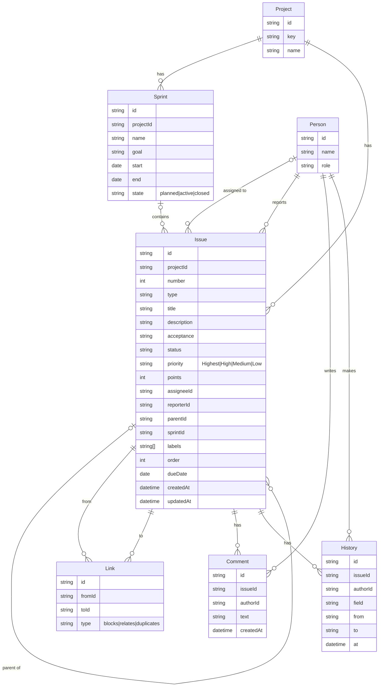

# Модель данных

## Сущности

- **Project** — проект; `key` (например, `DEMO`) формирует номера задач вида `DEMO-12`.
- **Person** — участник команды с ролью.
- **Sprint** — спринт проекта с целью, датами и состоянием `planned | active | closed`.
- **Issue** — задача любого типа (Epic, Story, Task, Bug, Sub-task); `parentId` задаёт иерархию, `sprintId = null` означает бэклог, `order` — ручной порядок.
- **Link** — связь между двумя задачами: `blocks | relates | duplicates`.
- **Comment** — комментарий к задаче.
- **History** — запись об изменении поля задачи (кто, что, было → стало, когда).

Итоги по людям и спринтам не хранятся — считаются из задач и истории. Бакеты доски — это группировка по полю, отдельной сущности для них нет.

## Поля

| Сущность | Поля |
|----------|------|
| Project | id, key, name |
| Person | id, name, role |
| Sprint | id, projectId, name, goal, start, end, state (planned\|active\|closed) |
| Issue | id, projectId, number, type, title, description, acceptance, status, priority (Highest\|High\|Medium\|Low), points, assigneeId, reporterId, parentId, sprintId, labels[], order, dueDate, createdAt, updatedAt |
| Link | id, fromId, toId, type (blocks\|relates\|duplicates) |
| Comment | id, issueId, authorId, text, createdAt |
| History | id, issueId, authorId, field, from, to, at |

## ER-диаграмма

