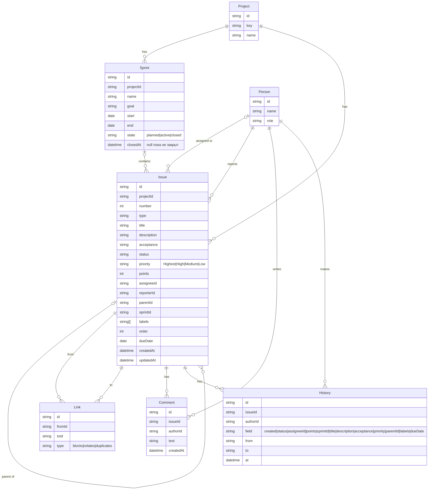

# Модель данных

## Сущности

- **Project** — проект; `key` (например, `DEMO`) формирует номера задач вида `DEMO-12`.
- **Person** — участник команды с ролью.
- **Sprint** — спринт проекта с целью, плановыми датами, состоянием `planned | active | closed` и фактическим временем закрытия `closedAt`.
- **Issue** — задача любого типа (Epic, Story, Task, Bug, Sub-task); `parentId` задаёт иерархию, `sprintId = null` означает бэклог, `order` — ручной порядок.
- **Link** — связь между двумя задачами: `blocks | relates | duplicates`.
- **Comment** — комментарий к задаче.
- **History** — запись о событии с задачей: создание, смена статуса, исполнителя, points или спринта (кто, что, было → стало, когда).

Итоги по людям и спринтам не хранятся — считаются из задач и истории. Бакеты доски — это группировка по полю, отдельной сущности для них нет.

## Демо-данные

Файл `data/seed.json` — набор всех сущностей плюс поле `version` (целое ≥ 1). Если сохранённые в браузере данные относятся к другой версии seed, приложение сбрасывает их и сообщает об этом ([ADR-006](adr/006-demo-author-and-order.md)). При изменении seed версию нужно увеличить.

## Ключевые правила

- Номер задачи уникален в проекте; полный номер — `KEY-число`.
- `sprintId = null` — задача в бэклоге; `order` задаёт порядок.
- Иерархия (`parentId`): Epic → Story, Task или Bug → Sub-task. Epic — без родителя; Story, Task и Bug — внутри Epic или без родителя (Task в Story не вкладывается); Sub-task — только внутри Story, Task или Bug.
- Sub-task всегда в том же спринте, что и родитель, и переносится вместе с ним.
- Story points (целое ≥ 0) есть только у Story, Task и Bug; у Epic и Sub-task `points = null`.
- Статус задачи — любой из пяти; допустим любой переход, каждая смена пишется в History. Статус Epic задаётся вручную.
- `Sprint.closedAt` — дата и время фактического закрытия (UTC); задано только у закрытого спринта. Velocity считается на этот момент.
- Закрытый спринт — только чтение: после `closedAt` его задачи не меняются (кроме переноса незавершённых в момент закрытия).
- Прогресс Epic вычисляется из points его потомков Story, Task и Bug (всего, в Done, %), не хранится и не входит в velocity и burndown.
- Связь не ссылается на саму себя и не повторяется.
- Одновременно активен не более одного спринта проекта.

### События History

History только добавляется. Поле `field` принимает значения:

| field | from | to | Когда пишется |
|-------|------|----|---------------|
| `created` | `null` | начальный статус (`Backlog`) | при создании задачи |
| `status` | прежний статус | новый статус | при каждой смене статуса |
| `sprintId` | прежний спринт или `null` | новый спринт или `null` | при первой установке спринта, переносе и возврате в бэклог |
| `assigneeId` | прежний исполнитель или `null` | новый исполнитель или `null` | при смене исполнителя |
| `points` | прежние points или `null` | новые points или `null` | при смене оценки |
| `title`, `description`, `acceptance` | прежний текст | новый текст | при правке соответствующего поля |
| `priority` | прежний приоритет | новый приоритет | при смене приоритета |
| `parentId` | прежний родитель или `null` | новый родитель или `null` | при смене родителя |
| `labels` | прежние метки через запятую или `null` | новые метки или `null` | при смене меток |
| `dueDate` | прежний срок или `null` | новый срок или `null` | при смене срока |

Если задача сразу создаётся в спринте, пишутся `created` и затем `sprintId` (`null` → спринт). По истории и текущим значениям можно восстановить состояние задачи и состав спринта на любой момент: записи применяются в обратном порядке. На этом строятся burndown и velocity ([ADR-003](adr/003-business-rules.md)).

## Поля

| Сущность | Поля |
|----------|------|
| Project | id, key, name |
| Person | id, name, role |
| Sprint | id, projectId, name, goal, start, end, state (planned\|active\|closed), closedAt (дата и время или null) |
| Issue | id, projectId, number, type, title, description, acceptance, status, priority (Highest\|High\|Medium\|Low), points, assigneeId, reporterId, parentId, sprintId, labels[], order, dueDate, createdAt, updatedAt |
| Link | id, fromId, toId, type (blocks\|relates\|duplicates) |
| Comment | id, issueId, authorId, text, createdAt |
| History | id, issueId, authorId, field (created\|status\|assigneeId\|points\|sprintId\|title\|description\|acceptance\|priority\|parentId\|labels\|dueDate), from, to, at |

## ER-диаграмма

