# Макеты экранов team-tracker

Версия документа 0.7. Статус продукта: в разработке. Этап 2: скетчи экранов; решения по макетам приняты на этапе 3 ([ADR-004](adr/004-screen-decisions.md)).

## 1. Как читать макеты

- Макеты низкой детализации: показывают состав экрана, расположение и поведение, а не финальный дизайн (цвета, шрифты, иконки уточняются при реализации).
- Все данные на макетах взяты из `data/seed.json` (проект DEMO), поэтому названия задач, суммы points и burndown совпадают с демо-данными.
- Красные кружки с цифрами связывают элемент макета с пояснением под ним.
- Макеты рассчитаны на настольный браузер. Мобильная версия в MVP не входит.
- Порядок экранов: карта, проекты, бэклог, доска, спринты, закрытие спринта, карточка задачи, создание задачи, отчёты, люди, настройки, поиск и клавиши.

Обозначения в списках задач: буква в рамке — тип (E — Epic, S — Story, T — Task, B — Bug, s — Sub-task); круг с числом — story points; суммы — в `sp`; два символа в круге — инициалы исполнителя; `▲▲ ▲ ■ ▼` — приоритет Highest, High, Medium, Low.

Общий каркас приложения на всех экранах проекта:

- адресная строка: у каждого экрана свой адрес, который можно отправить коллеге;
- верхняя панель: название, переключатель проекта, вкладки «Бэклог», «Доска», «Спринты», «Отчёты», «Люди», «Настройки», поиск (клавиша `/`), меню профиля (в демо-режиме в нём кнопка «Сбросить данные»). Тема светлая или тёмная выбирается по настройке системы; ручной переключатель — позже.

## 2. Карта экранов и адресов

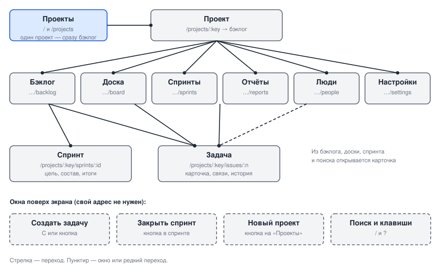

Из бэклога, доски, спринта и поиска открывается карточка задачи. Создание задачи, закрытие спринта, новый проект, поиск и подсказка клавиш — окна поверх экрана без отдельного адреса. Основа — [capabilities.md](capabilities.md), функция F-23.

## 3. Проекты

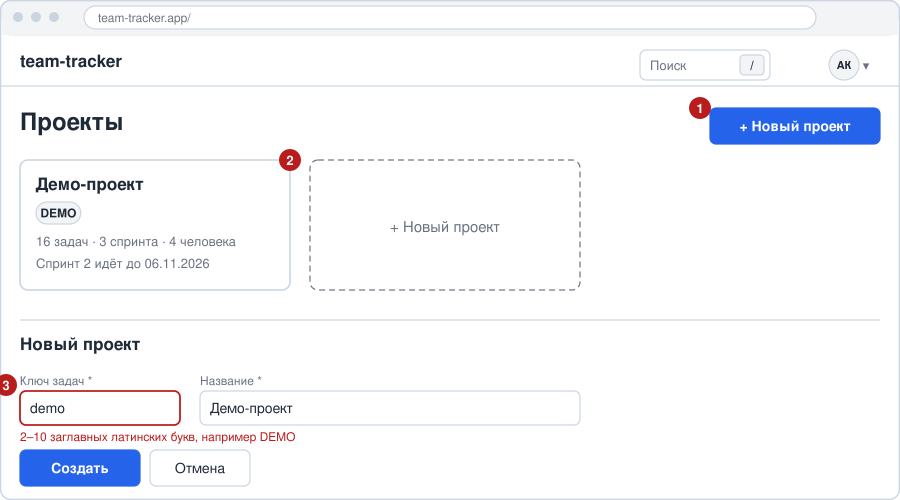

Адреса: `/` и `/projects`. Функция F-01. Если проект один, `/` сразу открывает его бэклог; список проектов остаётся доступным по адресу `/projects` и из переключателя проекта.

1. Кнопка «+ Новый проект».
2. Карточка проекта: название, ключ, число задач, спринтов и людей, активный спринт. Клик открывает бэклог проекта.
3. Форма нового проекта. Ключ — 2–10 заглавных латинских букв; при ошибке поле подсвечивается и объясняется, что исправить. Если ключ занят, предлагается выбрать другой.

## 4. Бэклог

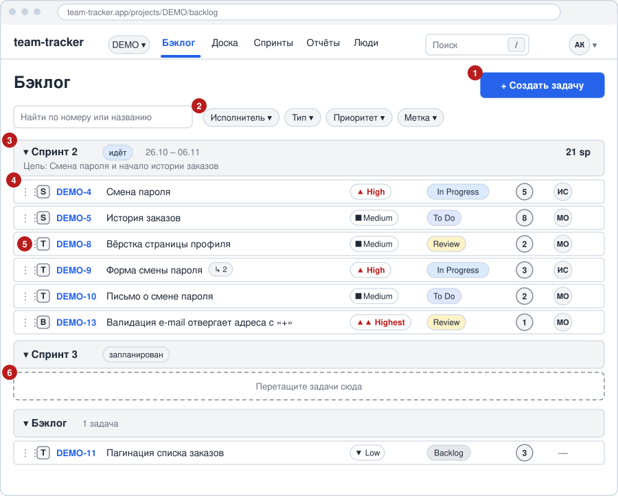

Адрес: `/projects/DEMO/backlog`. Функции F-07, F-12, F-20.

> **Предложение (раздел 17, ADR-014, черновик):** вкладка станет главным экраном планирования — см. [новый эскиз](#17-доска-прошлоетекущеебудущее-и-новый-бэклог-эскиз).

1. «Создать задачу» открывает окно создания (клавиша `C`).
2. Поиск по номеру или названию и фильтры по исполнителю, типу, приоритету и метке; фильтры сочетаются по «и».
3. Заголовок спринта: название, состояние, даты, цель, сумма points.
4. Строка задачи: тип, номер, название, приоритет, статус, points, исполнитель; значок «↳ 2» — число подзадач. Клик открывает карточку.
5. Ручка слева — перетаскивание: порядок задаётся положением в списке.
6. Пустая зона спринта: задачи перетаскиваются в спринт и обратно в бэклог.

Состояния: пустой бэклог — подсказка «Создайте первую задачу»; нет совпадений с фильтром — «Ничего не найдено» и кнопка «Сбросить фильтры».

## 5. Доска

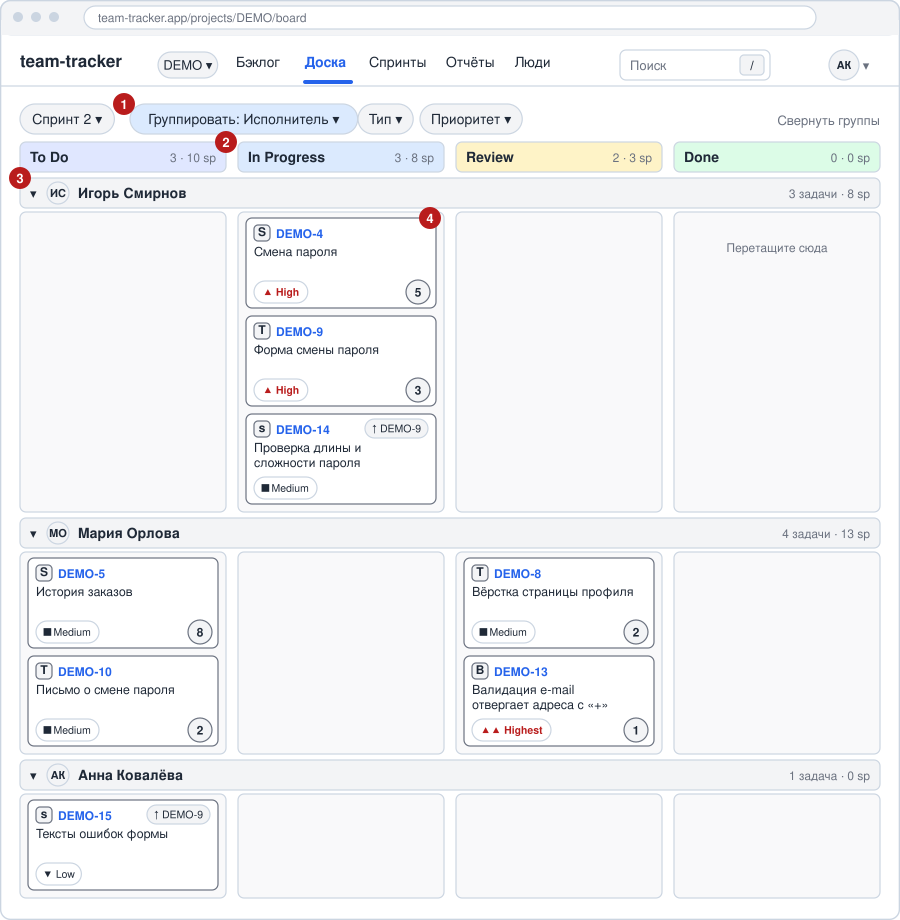

Адрес: `/projects/DEMO/board`. Функции F-10, F-11, F-04.

1. Выбор спринта и группировка по полю (исполнитель, тип, приоритет, родитель и другие). Выбор запоминается. Среди групп есть «по родителю».
2. Колонки статусов To Do, In Progress, Review, Done с числом задач и суммой points. Колонка Backlog на доске не показывается: на доске только задачи спринта.
3. Строка группы: исполнитель, число задач и points; группу можно свернуть. Задачи без значения попадают в группу «Не задано».
4. Карточка: тип, номер, название, приоритет, points. Sub-task — отдельная карточка с меткой родителя («↑ DEMO-9»). Перетаскивается между колонками или меняет статус с клавиатуры; допустим любой переход, смена пишется в историю.

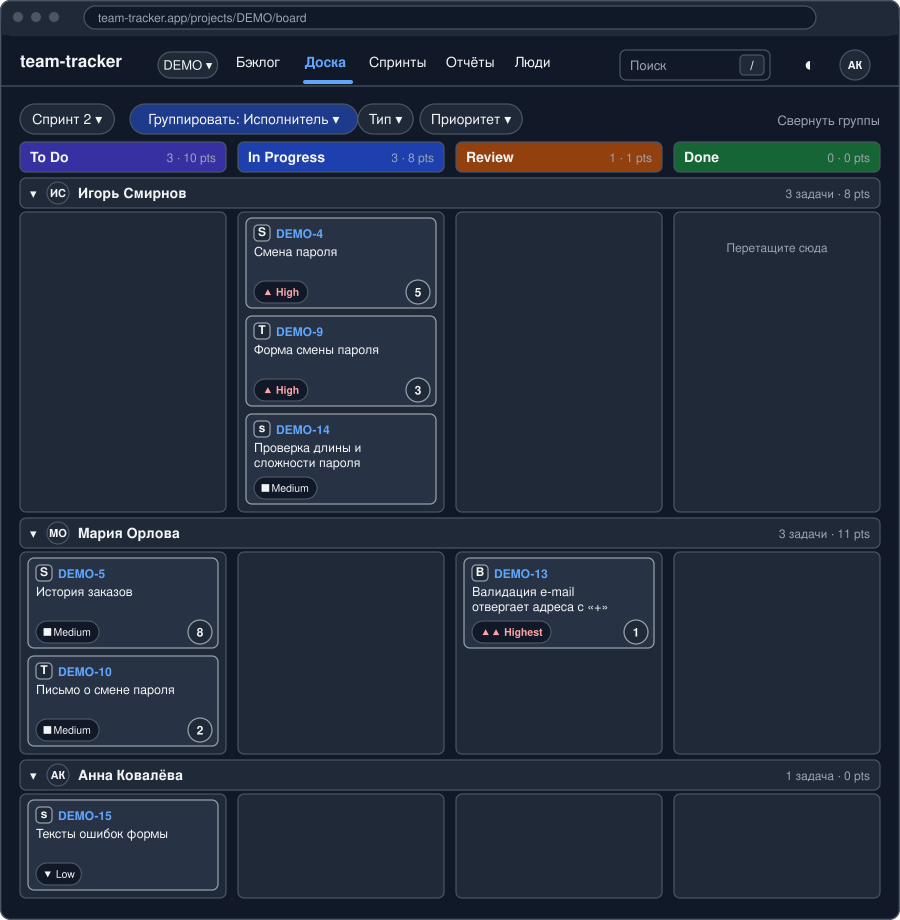

Та же доска в тёмной теме (F-24; тема выбирается по настройке системы): структура и размещение не меняются, цвета статусов и приоритетов остаются различимыми, контраст текста не ниже рекомендаций WCAG AA.

## 6. Спринты

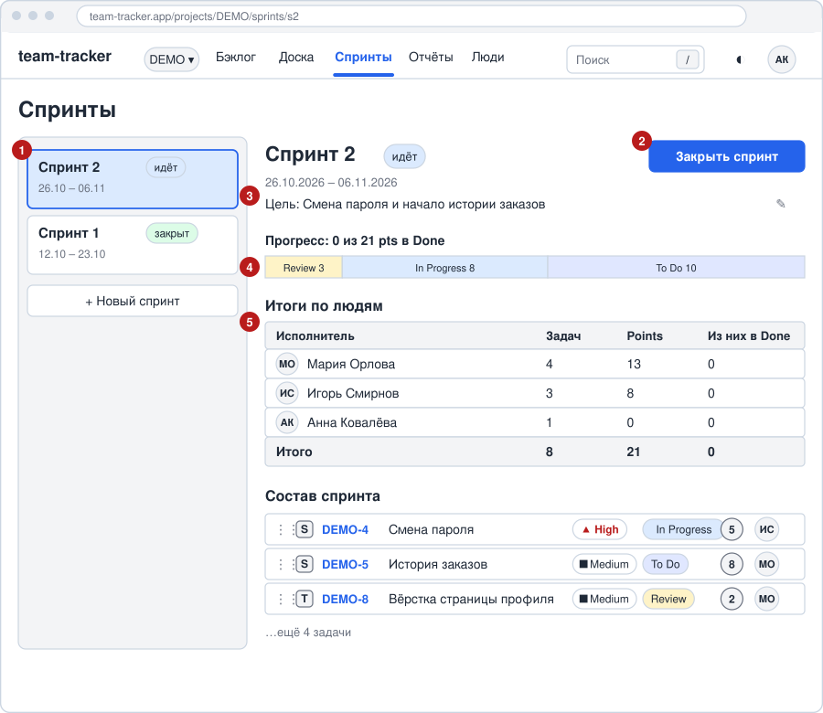

Адреса: `/projects/DEMO/sprints` (открывает идущий спринт) и `/projects/DEMO/sprints/s2`. Функции F-08, F-13.

1. Список спринтов проекта: идущий, запланированные, закрытые; «+ Новый спринт» открывает форму с названием, датами и длительностью из настроек проекта (раздел 12а).
2. Кнопки спринта: у запланированного «Запустить спринт» (при идущем другом — понятная ошибка), у идущего «Закрыть спринт» (окно закрытия), «Изменить» — название, цель и даты.
3. Цель спринта редактируется на месте (✎).
4. Прогресс: story points по статусам.
5. Итоги по людям: задач, sp и сколько из них в Done; суммы считаются, не хранятся. У закрытого спринта состав и итоги заморожены на момент закрытия.

## 7. Закрытие спринта

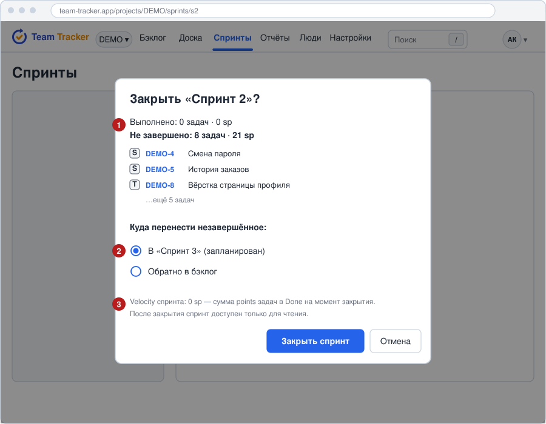

Окно поверх экрана спринта. Функция F-09.

1. Сводка: сколько выполнено и сколько не завершено (на демо-данных ещё ничего не в Done); первые незавершённые задачи списком. Незавершённые подзадачи выполненного родителя остаются в закрытом спринте — об этом предупреждение.
2. Выбор: в один из запланированных спринтов, обратно в бэклог или в новый спринт, который создаётся прямо в окне (название и даты подставляются из настроек). Подзадачи переносятся вместе с родителем.
3. Подсказка: velocity — сумма story points задач в Done на момент закрытия; закрытый спринт доступен только для чтения.

## 8. Карточка задачи

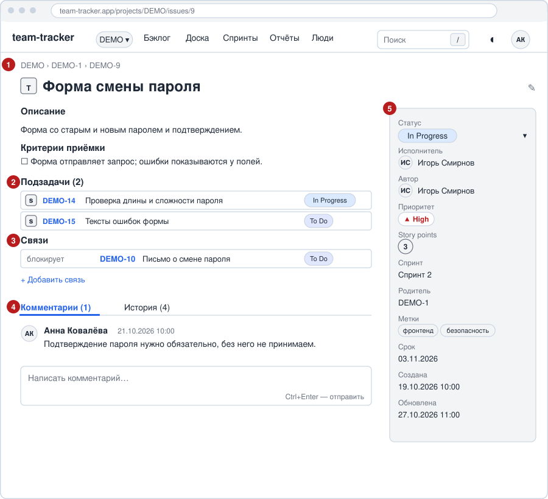

Адрес: `/projects/DEMO/issues/9`. Функции F-03–F-06, F-12, F-17.

1. Хлебные крошки показывают родителей: проект › Epic › Task.
2. Подзадачи со статусами.
3. Связи: «блокирует», «связана с», «дубликат». Добавляются кнопкой «Добавить связь». Если задачу блокирует незавершённая, показывается предупреждение.
4. Вкладки «Комментарии» и «История».
5. Боковая панель: статус, исполнитель, автор, приоритет, points, спринт, родитель, метки, срок, даты. Поля меняются на месте; у Sub-task и Epic points не ставятся.

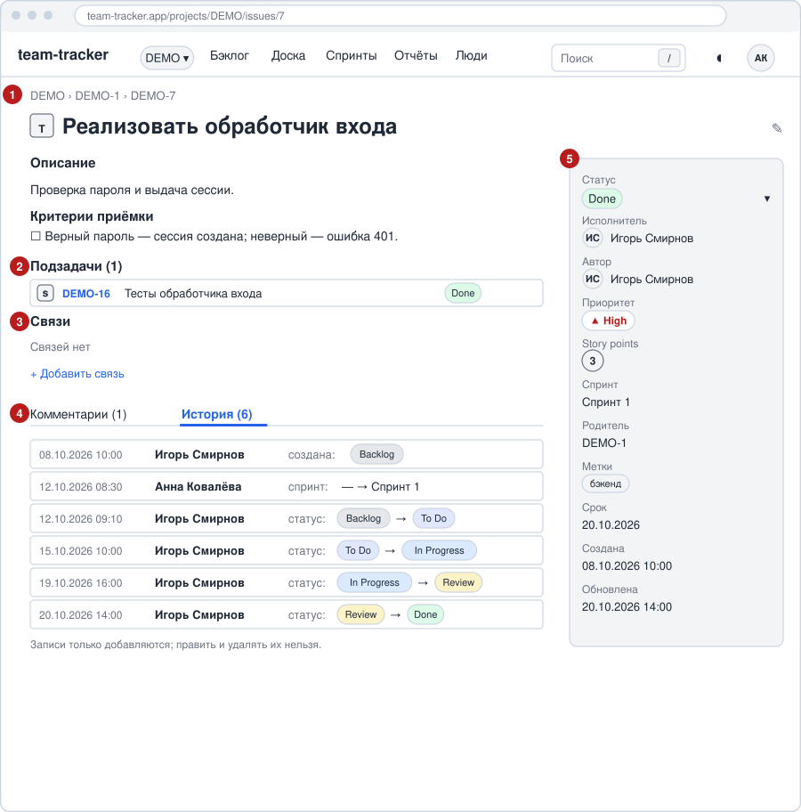

Вкладка «История» (F-19): кто, когда и какое поле изменил, значения «было → стало». В истории видны создание задачи и каждое изменение её полей, в том числе смены спринта (и перенос при закрытии). Записи только добавляются; править и удалять их нельзя.

## 9. Создание задачи

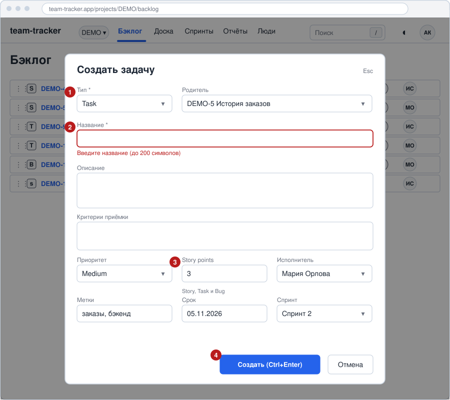

Окно поверх экрана; открывается кнопкой или клавишей `C`. Функции F-03, F-05, F-12, F-26.

1. Тип и родитель; список родителей зависит от типа: Epic — без родителя; Story, Task и Bug — Epic (или без родителя); Sub-task — Story, Task или Bug. Спринт Sub-task берётся у родителя.
2. Название обязательно (до 200 символов); при ошибке поле подсвечивается, под ним — понятное сообщение.
3. Story points доступны только для Story, Task и Bug; для Sub-task и Epic поле скрыто.
4. «Создать» (Ctrl+Enter) и «Отмена» (Esc). Несохранённый ввод не теряется при случайном закрытии окна.

## 10. Отчёты

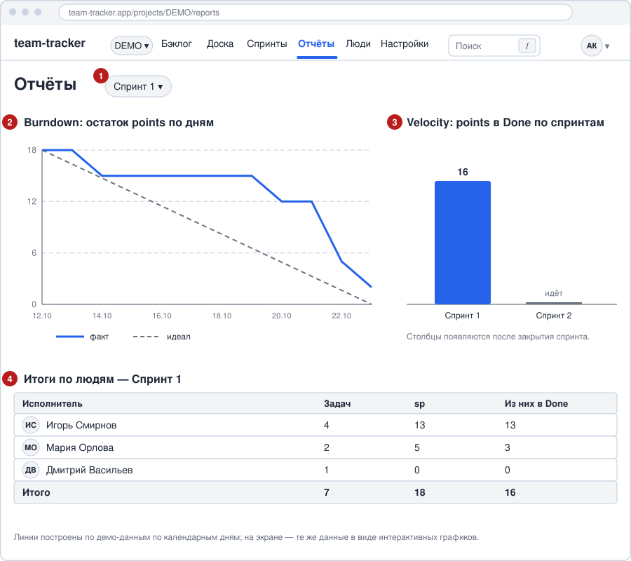

Адрес: `/projects/DEMO/reports` (`?sprint=s1` — другой спринт). Функции F-13–F-15, [ADR-009](adr/009-reports.md).

1. Выбор спринта (идущий и закрытые; по умолчанию идущий).
2. Burndown: остаток sp по календарным дням. Пунктир — идеальная линия, сплошная — факт; состав спринта по дням берётся из событий смены спринта, поэтому добавление задач посреди спринта видно как рост остатка. У закрытого спринта отчёт заморожен на момент закрытия: «Спринт 1» закрыт с остатком 2 sp, эта задача перенесена в «Спринт 2». У идущего спринта дни после сегодняшнего без данных.
3. Velocity: sp в Done на момент закрытия по закрытым спринтам, пунктир — среднее; идущий спринт — столбец «в процессе», в среднее он не входит.
4. Итоги по людям для выбранного спринта.

Под каждым графиком есть таблица данных («Таблица данных»), у графиков — текстовое описание. Пустые состояния: у спринта без задач с оценкой — пояснение вместо графика; нет закрытых спринтов — пояснение вместо velocity; нет запущенных спринтов — пояснение вместо отчётов.

## 11. Люди

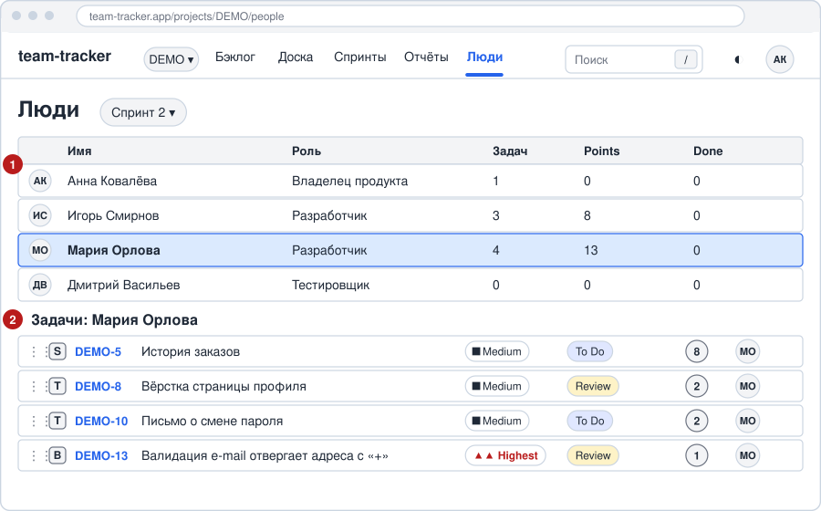

Адрес: `/projects/DEMO/people` (`?sprint=…`). Функция F-13.

1. Участники проекта (в том числе без задач в спринте): роль, число задач, sp и sp в Done за выбранный спринт; по умолчанию идущий.
2. Выбранный участник: список его задач в спринте; клик по номеру открывает карточку.
3. Раздел «Учётки и роли» — только при работе с сервером ([ADR-010](adr/010-server-auth-roles.md), [ADR-011](adr/011-local-pglite.md)): все видят имена и роли, администратор — ещё почты, выбор роли, форму «Новый участник» (временный пароль показывается один раз) и «Сбросить» пароль.

## 11а. Вход и регистрация

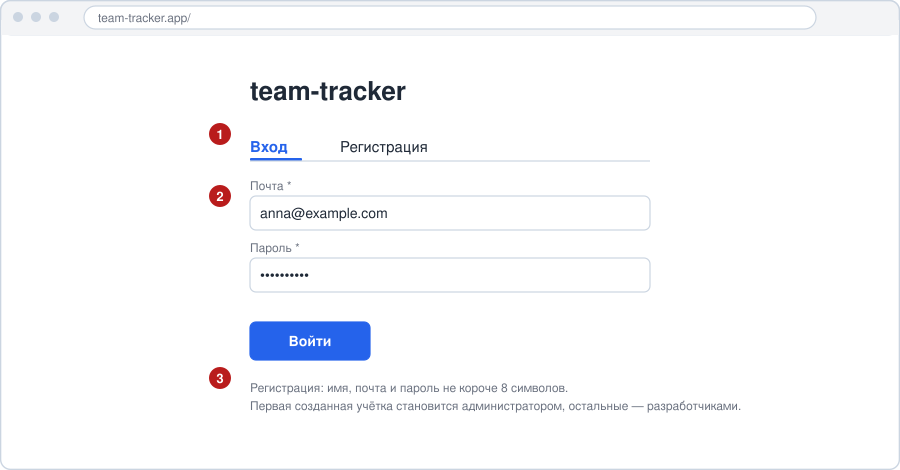

Вверху — логотип Team Tracker ([ADR-013](adr/013-logo-and-palettes.md)). Адрес любой страницы при работе с сервером, если нет сессии ([ADR-010](adr/010-server-auth-roles.md)). Демо на GitHub Pages входа не имеет.

1. Вкладка «Вход»; вкладка «Регистрация» (с полем «Имя») есть, только если регистрация разрешена (`ALLOW_REGISTRATION=true`) — по умолчанию её нет.
2. Почта и пароль; ошибки (неверная почта или пароль, занятая почта, короткий пароль) показываются под полями.
3. Подсказка: учётки создаёт администратор; пока администратора нет, показывается подсказка `npm run admin:create`. Если вход выполнен с временным паролем, открывается экран «Смените пароль» (текущий, новый, повтор). После входа открывается страница, на которую шёл пользователь. Меню профиля показывает почту и роль, кнопка «Выйти».

## 12. Настройки проекта

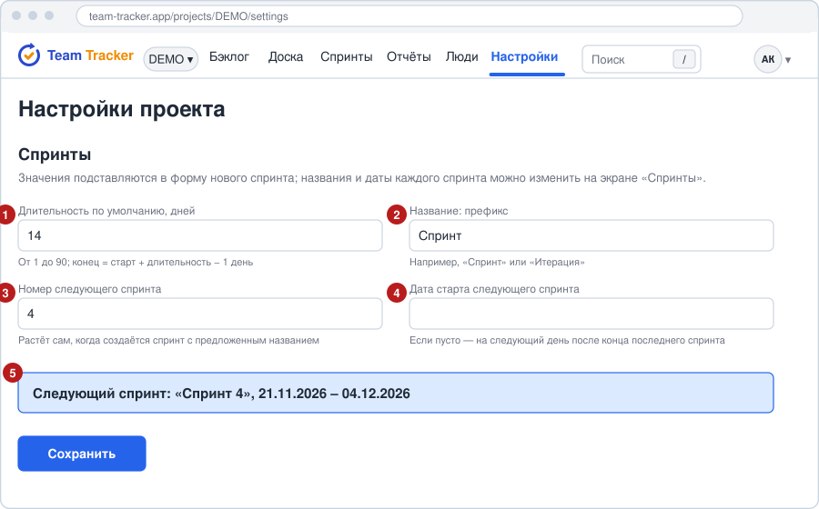

Адрес: `/projects/DEMO/settings`. Функция F-28.

1. Длительность спринта по умолчанию в днях (1–90); конец нового спринта = старт + длительность − 1 день.
2. Префикс названия спринта, например «Спринт» или «Итерация».
3. Номер следующего спринта; растёт сам, когда создаётся спринт с предложенным названием.
4. Дата старта следующего спринта; если пусто — на следующий день после конца последнего спринта.
5. Предпросмотр следующего спринта по введённым значениям. Ошибки проверки показываются у полей.

## 12а. Резервные копии (скетч)

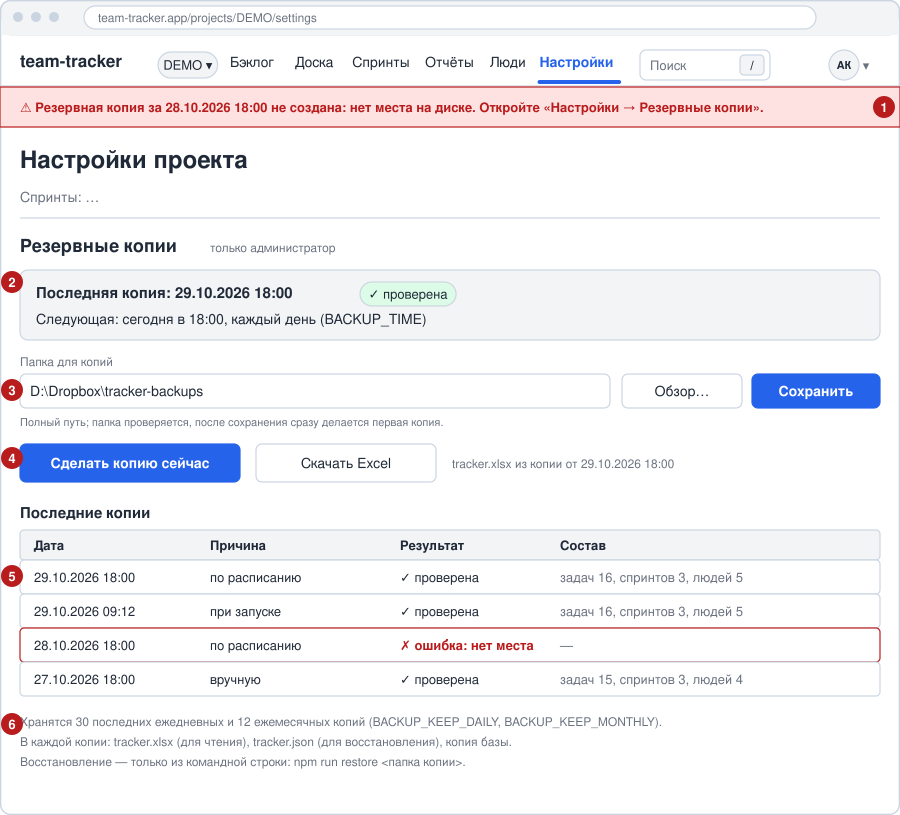

Блок на экране «Настройки» (`/projects/DEMO/settings`) и предупреждение на любом экране — **только для администратора** ([ADR-012](adr/012-backups.md)). Обычные участники их не видят.

1. **Предупреждение** красной полосой под верхней панелью: показывается, если последняя копия не создана или проверка не прошла, либо копии нет больше двух суток. Ведёт в этот блок.
2. **Состояние:** дата и время последней копии, результат проверки (✓ проверена или ✗ ошибка с причиной), время следующей по расписанию (`BACKUP_TIME`).
3. **Папка для копий — выбор места хранения:** поле с полным путём, кнопка «Обзор…» (окно со списком папок компьютера, на котором работает трекер: переход вглубь и вверх, «Выбрать эту папку») и «Сохранить». Путь проверяется (в папку должно быть можно записать, она не может лежать внутри папки данных базы), выбор хранится в базе и сильнее `BACKUP_DIR`. После сохранения сразу делается первая копия; прежние копии остаются на старом месте. Подойдёт и папка облачного диска (Dropbox, OneDrive, Яндекс.Диск).
4. **Кнопки:** «Сделать копию сейчас» (трекер при этом не останавливается; пока идёт копирование, кнопка занята) и «Скачать Excel» — `tracker.xlsx` из последней проверенной копии.
5. **Список последних копий:** дата, причина (по расписанию, при запуске, вручную, смена папки), результат, состав. Ошибки подсвечены.
6. **Справка:** сколько копий хранится, что лежит в копии, как восстановить (только командой `npm run restore <папка копии>`: восстановление заменяет все данные, поэтому из интерфейса оно недоступно).

## 12б. Цветовая гамма (скетч)

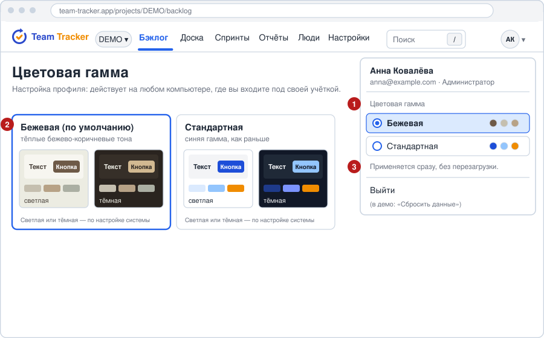

Настройка профиля пользователя, доступна любой роли: в меню профиля (кнопка с именем справа вверху) — блок «Цветовая гамма» ([ADR-013](adr/013-logo-and-palettes.md)).

1. **Выбор гаммы** — две опции с образцами цветов: «Бежевая» (по умолчанию) и «Стандартная» (синяя, как раньше). Выбранная подсвечена. Светлая или тёмная версия гаммы по-прежнему определяется настройкой системы (`prefers-color-scheme`).
2. **Предпросмотр** (на макете показан для наглядности, в приложении его нет): каждая гамма состоит из светлой и тёмной версий; основные цвета, кнопка и дополнительные оттенки.
3. **Применение:** сразу, без перезагрузки. С сервером выбор сохраняется в профиле (виден с любого компьютера); в демо-режиме — в браузере.

## 13. Поиск и горячие клавиши

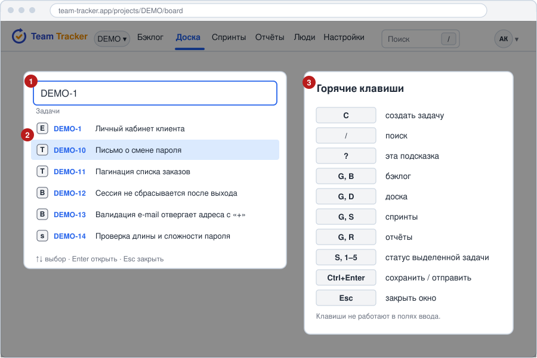

Окна поверх любого экрана. Функции F-20, F-22.

1. Поле поиска открывается клавишей `/`; ищет по номеру и части названия без учёта регистра.
2. Результаты выбираются стрелками, `Enter` открывает карточку, `Esc` закрывает окно.
3. Подсказка по клавишам открывается клавишей `?`.

Набор клавиш:

| Клавиши | Действие |
|---------|----------|
| `C` | создать задачу |
| `/` | поиск |
| `?` | подсказка по клавишам |
| `G`, затем `B` / `D` / `S` / `R` | перейти в бэклог / на доску / в спринты / в отчёты |
| `S`, затем `1`–`5` | сменить статус выделенной задачи (Backlog, To Do, In Progress, Review, Done) |
| `Ctrl+Enter` | сохранить форму или отправить комментарий |
| `Esc` | закрыть окно |

Клавиши не срабатывают, пока фокус в поле ввода.

## 14. Общие состояния экранов

- **Загрузка:** на месте списка — заглушки строк; интерфейс не блокируется.
- **Пусто:** понятное сообщение и главное действие («Создать задачу», «Создать спринт»).
- **Ошибка:** сообщение объясняет, что случилось и что сделать; кнопка «Повторить», если действие можно повторить.
- **Нет прав** (после появления входа): действие скрыто или недоступно с пояснением, а не молчит.
- **Доступность:** весь функционал доступен с клавиатуры, фокус виден, порядок табуляции совпадает с визуальным.

## 15. Реализация: отличия от макетов (этапы 4–6)

Этап 4 реализует экраны «Проекты», «Бэклог» и «Карточка задачи», окно создания задачи (F-01…F-07, F-17, F-19, F-26). Отличия:

- **Бэклог:** нет строки поиска и фильтров (F-20) и горячих клавиш (F-22) — они в следующих этапах. Нет раздела «Спринт 3»: спринты создаются на этапе 6, поэтому показываются только существующие. Добавлены список «Переместить…» в строке (доступная замена перетаскиванию) и подсказка под списками.
- **Карточка задачи:** название, описание и критерии редактируются кнопкой «Изменить название и описание» вместо значка ✎; у Epic вместо подзадач список «Задачи эпика»; в боковой панели можно менять родителя.
- **Меню профиля:** добавлен выбор «Работаю как» — автор действий в демо-режиме ([ADR-006](adr/006-demo-author-and-order.md)).
- **Проекты:** форма создания проекта открывается кнопкой «+ Новый проект», а не показана всегда.
- **Epic:** в строке бэклога вместо кружка points и в карточке (раздел «Прогресс») показывается вычисляемый прогресс: points потомков всего, в Done и % ([ADR-003](adr/003-business-rules.md), п. 12). На макетах его нет.
- **История:** в ней видны не только статус, исполнитель, points и спринт, но и правки остальных полей ([ADR-003](adr/003-business-rules.md), п. 11).

- **Доска (этап 5):** в карточке добавлен выбор статуса (доступная замена перетаскиванию с клавиатуры); у карточки Sub-task — метка родителя; перенос в колонку другой группы не выполняется (подсказка вместо переноса). Если в спринте есть задачи в статусе Backlog, над доской показывается предупреждение с кнопкой «Перевести в To Do». Фильтры доски — по типу и приоритету ([ADR-007](adr/007-board.md)).
- **Отчёты и «Люди» (этап 7):** выбор спринта в обоих экранах; под графиками добавлены таблицы данных и текстовые описания; в «Люди» показаны все участники, выбор строки меняет список задач ([ADR-009](adr/009-reports.md)).
- **Спринты (этап 6):** в списке спринтов показаны и запланированные; добавлены кнопки «Изменить» и «Запустить спринт»; в окне закрытия можно выбрать любой запланированный спринт. Вкладка «Настройки» и экран настроек добавлены по запросу (раздел 12а; [ADR-008](adr/008-sprints.md)).
- **Роли (этап 8):** при работе с сервером недоступные роли действия скрыты или отключены: у Разработчика нет перетаскивания в бэклоге и выбора спринта, статус можно менять только у своих задач; кнопки спринтов и настройки спринтов — у Тимлида и Администратора; «+ Новый проект» — у Администратора ([ADR-010](adr/010-server-auth-roles.md)). Добавлены экран входа, экран смены временного пароля и раздел «Учётки и роли» на экране «Люди» (форма «Новый участник» со сгенерированным временным паролем, кнопка «Сбросить» пароль).
- **Обозначение story points:** в интерфейсе и на макетах суммы пишутся как `sp` (раньше на макетах было `pts`).

## 16. Принятые решения

Решения по макетам закреплены в [ADR-004](adr/004-screen-decisions.md).

| № | Вопрос | Решение |
|---|--------|---------|
| 1 | Колонка Backlog на доске | Не показывается; на доске только задачи спринта |
| 2 | Sub-task на доске | Отдельные карточки с меткой родителя; среди группировок есть «по родителю» |
| 3 | Горячие клавиши | Набор из раздела 13 плюс смена статуса выделенной задачи (`S`, затем `1`–`5`) |
| 4 | Тема | По настройке системы (`prefers-color-scheme`); ручной переключатель — позже |
| 5 | Закрытие спринта без следующего | Новый спринт создаётся из окна закрытия, отдельного шага нет |
| 6 | Экран «Проекты» | Есть; если проект один, `/` сразу открывает его бэклог |

## 17. Доска, «Прошлые спринты» и «Планирование будущих спринтов» (эскиз)

**Статус: эскиз согласован, код не написан.** Эскиз и черновик [ADR-014](adr/014-board-retro.md). Все эскизы нарисованы на одном сценарии: Спринт 1 и 2 закрыты (velocity 16 и 18), Спринт 3 идёт, Спринт 4 и 5 запланированы, общий бэклог — 9 задач. Это макеты, а не готовые экраны.

### 17.1. Три экрана и их роли

| | Доска («Текущий спринт») | «Прошлые спринты» | «Планирование будущих спринтов» |
|---|---|---|---|
| Задача | быстро увидеть, где мы, и менять статусы | вся история закрытых спринтов | подробное планирование: состав, порядок, оценка, исполнители |
| Содержимое | только активный спринт, как сейчас | закрытые спринты и их выполненные задачи, velocity | активный спринт, планируемые спринты, общий бэклог |
| Что можно | статус (drag по колонкам), группировка, фильтры | читать, фильтровать | drag между спринтами и порядок, правка points, приоритета, исполнителя, пакетный перенос, фильтры |
| Доступ | по ролям, как сейчас | все роли, только чтение | перенос и порядок — продакт, тимлид, администратор; остальным только чтение |

Решение 1 из [ADR-004](adr/004-screen-decisions.md) не меняется: на доске по-прежнему только задачи активного спринта (прошлое и будущее вынесены в отдельные вкладки).

### 17.2. Доска

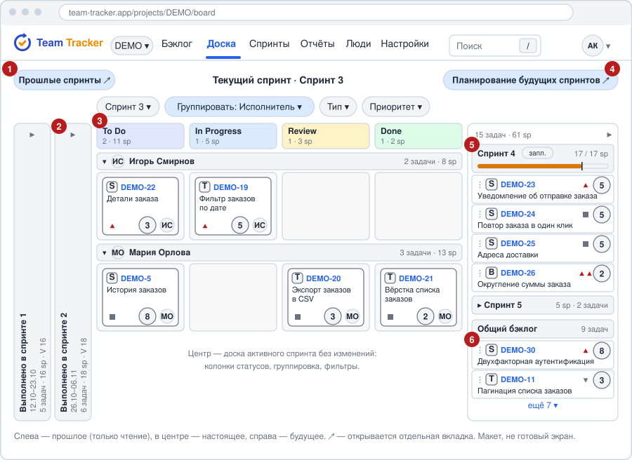

Доска остаётся как сейчас; сверху добавлены три плашки.

1. **«Прошлые спринты ↗»** — кнопка-ссылка: открывает вкладку «Прошлые спринты» (17.4а).
2. **«Текущий спринт · Спринт 3 · 09.11 – 20.11»** — выбранная плашка: номер и даты активного спринта.
3. **«Планирование будущих спринтов ↗»** — кнопка-ссылка: открывает вкладку планирования (17.4).
4. Фильтры доски, как сейчас. WIP-лимитов в продукте нет, на эскизе их нет.

### 17.4. Вкладка «Планирование будущих спринтов»

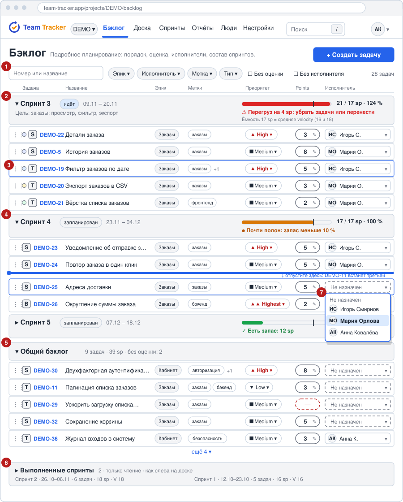

Открывается кнопкой «Планирование будущих спринтов ↗» на доске и из пункта «Бэклог» верхнего меню (вопрос 2).

1. **Фильтры:** поиск по номеру и названию, эпик, исполнитель, метка, тип, «Без оценки», «Без исполнителя». Условия складываются по И; счётчик показывает результат.
2. **Спринты сверху вниз:** активный (для справки и баланса), планируемые по номеру, внизу общий бэклог. У каждого — состояние, даты, цель и **индикатор заполнения**: points против ёмкости (среднее velocity последних 3 закрытых спринтов; в примере 17 sp). До 90 % — зелёный, 91–100 % — янтарный, больше 100 % — красный с надписью «Перегруз на N sp». Состояние выражено значком и словами, не только цветом.
3. **Активный спринт** с точкой статуса у каждой строки.
4. **Планируемые спринты.** Drag между любыми спринтами и бэклогом, порядок внутри списка; линия-указатель показывает, куда встанет задача.
5. **Общий бэклог** с суммой points и числом неоценённых; длинный список — порциями «ещё N ▾».
6. **«Выполненные спринты ↗»** — ссылка внизу на вкладку истории, без дублирования данных.
7. **Быстрая правка в строке:** points — поле ввода, приоритет и исполнитель — выпадающие списки; сохраняется сразу.
8. **Пакетный перенос:** отметить одну или несколько задач и выбрать «Перенести в спринт ▾» — Спринт 4, Спринт 5 или общий бэклог; так задачи можно закинуть сразу в любой будущий спринт.

### 17.4а. Вкладка «Прошлые спринты»

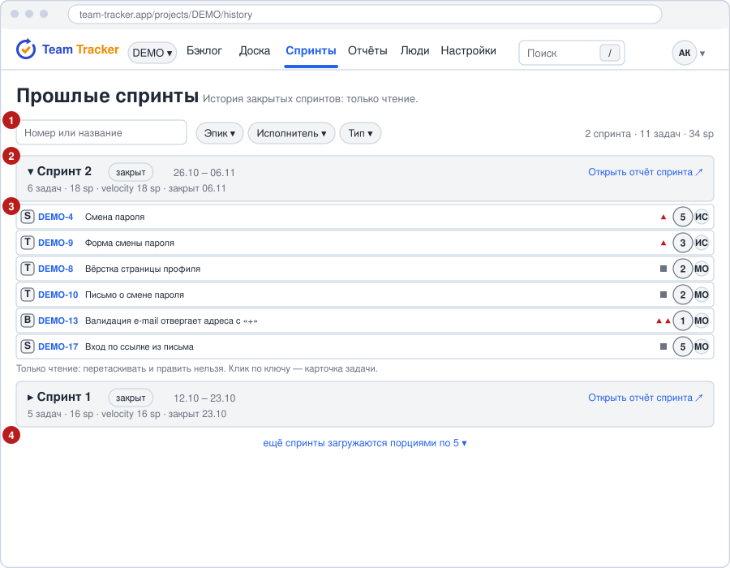

Открывается кнопкой «Прошлые спринты ↗» на доске. Только чтение.

1. Поиск и фильтры (эпик, исполнитель, тип); итог — число спринтов, задач и points.
2. **Заголовок спринта:** название, даты, число задач и points, velocity, дата закрытия; ссылка на отчёт спринта ([ADR-009](adr/009-reports.md)).
3. **Список выполненных задач** раскрытого спринта: ключ, название, приоритет, points, исполнитель.
4. Остальные спринты подгружаются порциями по 5.

### 17.5. Единый вид задачи

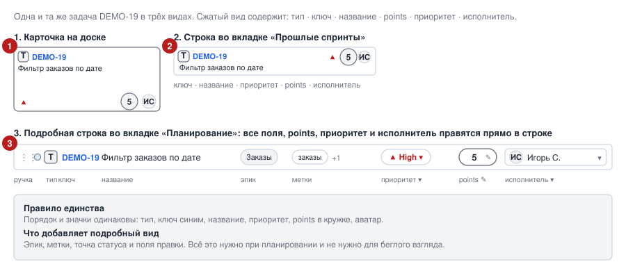

Порядок полей и значки одинаковы на доске, в истории и в планировании. **Сжатый вид:** тип · ключ · название · приоритет · points · исполнитель (карточка доски и строка истории). **Подробный вид** (планирование) добавляет эпик, метки, точку статуса и поля правки.

### 17.6. Ноутбук 1366 px

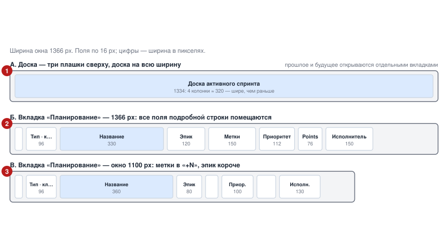

Доска занимает всю ширину (четыре колонки по ≈ 320 px, шире, чем при боковых панелях). Вкладка планирования при 1366 px вмещает все поля подробной строки; в окне уже 1100 px метки уходят в «+N», а эпик сокращается.

### 17.7. Предложения по взаимодействию

1. **Много закрытых спринтов:** во вкладке истории показываются последние 5, дальше — «ещё N ▾» порциями по 5.
2. **Перенос в будущие спринты:** drag на группу спринта или пакетно («Перенести в спринт ▾» для выбранных задач); можно сразу в любой будущий спринт.
3. **Клавиатура:** перенос без мыши — выбор спринта в списке «Перенести»; `G, P` — планирование (по образцу `G, B`/`G, D`).
4. **Строка планирования, строка истории и карточка доски** открывают одну и ту же карточку задачи (клик по ключу).

### 17.8. Принятые решения

Эскиз согласован; на вопросы выбраны предложенные варианты.

1. «Бэклог» в верхнем меню и «Планирование будущих спринтов» — **одна вкладка**.
2. Вкладка истории — **только кнопка на доске** (и ссылка внизу планирования), отдельного пункта меню нет.
3. **WIP-лимитов нет** (в продукте их не было); отдельным этапом — по желанию.
4. Ёмкость — среднее velocity до трёх последних закрытых спринтов; при меньшем числе — по имеющимся, при нуле — без процента. Пороги: до 90 % норма, 91–100 % почти полон, больше 100 % перегруз.
5. Неоценённые задачи считаются нулём и показываются отдельно («без оценки: N»).
6. При возврате задачи из активного спринта в бэклог статус **сбрасывается в To Do**.
7. Права разработчика **не меняются**: смотрит, но не перетаскивает и не правит поля.
8. Свёрнутой справки «Выполненные спринты» на вкладке планирования нет — только ссылка на историю.
